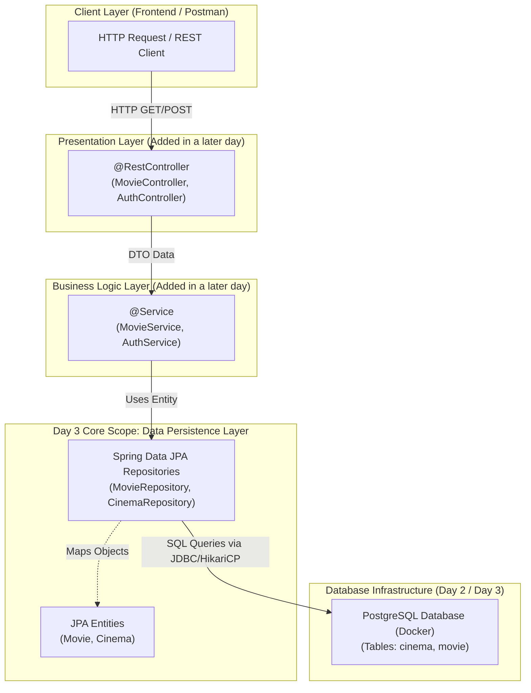
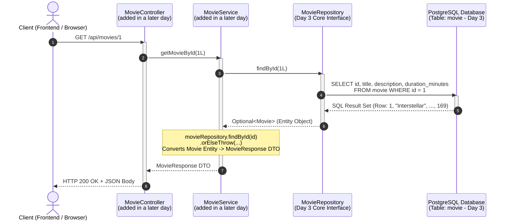

# Cine Cinema Backend - Day 3 අධ්‍යයන මාර්ගෝපදේශය (Study Guide)
## JPA Entities, Repositories, Package Structure සහ Database Setup

මෙම ලේඛනය (document) Cine Cinema ව්‍යාපෘතියේ (project) Day 3 හි සිදු කරන ලද සියලුම backend සංවර්ධන කටයුතු (development work) පිළිබඳව සිංහල මාධ්‍යයෙන් ඉදිරිපත් කර ඇති සවිස්තරාත්මක අධ්‍යයන සටහනකි. මෙහි අරමුණ වන්නේ කේත පදනමේ (codebase) ඇති සැබෑ කේතයන් (real code) නිවැරදිව තේරුම් ගෙන viva සහ mentor presentation සඳහා මනා සූදානමක් ලබා දීමයි.

---

## 1. Day 3 හි අරමුණ සහ එය සමස්ත පද්ධතියට ගැලපෙන ආකාරය (Day 3 Purpose and Where It Fits)

### Day 3 හි මූලික අරමුණ
Day 3 හි ප්‍රධානතම ඉලක්කය වන්නේ අපගේ Spring Boot යෙදුම (application) සහ PostgreSQL දත්ත සමුදාය (database) අතර සබඳතාවය ගොඩනඟන **දත්ත ස්ථරය හෙවත් Data Persistence Layer** නිර්මාණය කිරීමයි. මෙහිදී පහත ප්‍රධාන කාර්යයන් සිදු කර ඇත:
1. **JPA Entities නිර්මාණය කිරීම:** Java objects සහ PostgreSQL relational tables අතර දත්ත හුවමාරුව සඳහා `Cinema` සහ `Movie` යන Entity classes නිර්මාණය කිරීම.
2. **Spring Data JPA Repositories සැකසීම:** SQL queries අතින් නොලියා, දත්ත සමුදාය සමඟ CRUD (Create, Read, Update, Delete) මෙහෙයුම් සිදු කිරීමට `CinemaRepository` සහ `MovieRepository` interfaces නිර්මාණය කිරීම.
3. **ව්‍යාපෘති පැකේජ ව්‍යුහය (Package Structure) සැලසුම් කිරීම:** Layered Architecture (ස්ථරීකෘත ගෘහ නිර්මාණ ශිල්පය) මූලධර්මයට අනුව වගකීම් වෙන් කිරීම (Separation of Concerns).
4. **දත්ත සමුදා වින්‍යාසය (Database Configuration):** Docker හරහා ධාවනය වන PostgreSQL වෙත Spring Boot යෙදුම සම්බන්ධ කිරීම සඳහා `application.properties` සහ `schema.sql` සකස් කිරීම.

### සමස්ත පද්ධති ගෘහ නිර්මාණයේ Day 3 පිහිටීම (Architectural Fit)

පහත දැක්වෙන Mermaid සටහනෙන් සමස්ත Cine Cinema backend පද්ධතිය තුළ Day 3 කාර්යභාරය පැහැදිලි කෙරේ:



### මේක මට පැහැදිලිව කියන්න පුළුවන්ද?
1. **Day 3 හි ප්‍රධාන ඉලක්කය කුමක්ද, එය Day 2 සහ පසු දින (later days) සමඟ සම්බන්ධ වන්නේ කෙසේද?**
   - *පිළිතුර:* Day 2 හිදී Docker සහ build setup සකස් කළ අතර, Day 3 හිදී සිදු කළේ Database එක සහ Java කේතය සම්බන්ධ කරන Persistence Layer (Entities සහ Repositories) තැනීමයි. පසු දිනවල (later days) ලියන Service සහ Controller ස්ථර ක්‍රියාත්මක වන්නේ Day 3 හි හැදූ මෙම Repositories සහ Entities මතය.
2. **JPA (Java Persistence API) සහ ORM (Object-Relational Mapping) යනු මොනවාද?**
   - *පිළිතුර:* ORM යනු Java objects (OOP) සහ Relational Database tables අතර දත්ත ස්වයංක්‍රීයව පරිවර්තනය කරන තාක්ෂණයයි. JPA යනු Java හි ORM සඳහා වන සම්මත නිර්දේශය (specification) වන අතර Hibernate යනු එහි සැබෑ ක්‍රියාත්මක කිරීමයි (implementation).
3. **Repository එකක් සහ Entity එකක් අතර ඇති වෙනස කුමක්ද?**
   - *පිළිතුර:* Entity යනු Database table එකක එක් පේළියක් (row) නියෝජනය කරන Java Class එකකි (දත්ත රඳවා තබා ගනී). Repository යනු එම Entity එක භාවිතයෙන් Database එක වෙත SQL queries යවා දත්ත ලබා ගැනීමට හෝ වෙනස් කිරීමට ඇති interface එකකි (මෙහෙයුම් සිදු කරයි).

---

## 2. පැකේජ ව්‍යුහය (Package Structure)

Cine Cinema backend ව්‍යාපෘතියේ සැබෑ පැකේජ ගස (real tree) පහත පරිදි වේ:

```
backend/src/main/java/com/cinemaapp/cinema/
├── BackendApplication.java                     [Root Application Configuration]
├── config/                                     [Security and App Configurations]
│   ├── JwtAuthenticationFilter.java            (added in a later day)
│   ├── PasswordConfig.java                     (added in a later day)
│   └── SecurityConfig.java                     (added in a later day)
├── controller/                                 [REST API Controllers]
│   ├── AuthController.java                     (added in a later day)
│   ├── CinemaProfileController.java            (added in a later day)
│   └── MovieController.java                    (added in a later day)
├── dto/                                        [Data Transfer Objects]
│   ├── ApiErrorResponse.java                   (added in a later day)
│   ├── CinemaResponse.java                     (added in a later day)
│   ├── LoginRequest.java                       (added in a later day)
│   ├── LoginResponse.java                      (added in a later day)
│   ├── MovieRequest.java                       (added in a later day)
│   ├── MovieResponse.java                      (added in a later day)
│   ├── RegisterRequest.java                    (added in a later day)
│   └── UpdateCinemaProfileRequest.java         (added in a later day)
├── entity/                                     [Day 3 Scope: JPA Entities]
│   ├── Cinema.java                             (Day 3 Core)
│   └── Movie.java                              (Day 3 Core)
├── exception/                                  [Global Exception Handling]
│   ├── ApiErrorResponseWriter.java             (added in a later day)
│   ├── GlobalExceptionHandler.java             (added in a later day)
│   └── ResourceNotFoundException.java          (added in a later day)
├── repository/                                 [Day 3 Scope: Spring Data JPA Repositories]
│   ├── CinemaRepository.java                   (Day 3 Core)
│   └── MovieRepository.java                    (Day 3 Core)
└── service/                                    [Business Logic Layer]
    ├── AuthService.java                        (added in a later day)
    ├── CinemaProfileService.java               (added in a later day)
    ├── JwtService.java                         (added in a later day)
    └── MovieService.java                       (added in a later day)
```

### සෑම පැකේජයකම විස්තරය (Package Details)

| පැකේජය (Package) | පවතින හේතුව (Purpose) | සැබෑ උදාහරණ Class එක | මෙහි අඩංගු නොවිය යුතු දේ (What must NOT go here) |
|---|---|---|---|
| `entity` | Database tables නියෝජනය කරන JPA Entity classes තබා ගැනීම (Day 3 Core). | `Movie.java`, `Cinema.java` | HTTP requests, Controller logic, SQL query execution, Business calculations. |
| `repository` | Database එක සමඟ සෘජුවම CRUD මෙහෙයුම් සහ queries සිදු කරන Interfaces තබා ගැනීම (Day 3 Core). | `MovieRepository.java`, `CinemaRepository.java` | HTTP handling, password hashing, complex business rules, DTOs. |
| `service` | ව්‍යාපෘතියේ සියලුම ව්‍යාපාරික නීති (Business Logic) ක්‍රියාත්මක කිරීම. | `MovieService.java` (added in a later day) | Direct HTTP annotations (`@GetMapping`), direct SQL statements, UI rendering. |
| `controller` | පිටතින් එන HTTP Requests භාරගෙන Response ආපසු යැවීම. | `MovieController.java` (added in a later day) | Database queries, SQL, complex business rules, direct Entity persistence. |
| `dto` | Layer අතර හෝ Network හරහා දත්ත ආරක්ෂිතව හුවමාරු කිරීම (Data Transfer Objects). | `MovieRequest.java` (added in a later day) | JPA annotations (`@Entity`, `@Table`), business logic, DB connections. |
| `config` | Spring Security, Beans සහ System configurations අර්ථ දැක්වීම. | `SecurityConfig.java` (added in a later day) | Business domain models, Database CRUD queries. |
| `exception` | System එක තුළ හටගන්නා දෝෂ හසුරුවා පිරිසිදු JSON error messages සැකසීම. | `GlobalExceptionHandler.java` (added in a later day) | Normal business logic, database queries. |

### ස්ථරීකෘත ගෘහ නිර්මාණය (Controller -> Service -> Repository -> Database)
අපගේ ව්‍යාපෘතිය අනුගමනය කරන්නේ Industry-standard **Layered Architecture** රටාවයි:
1. **Controller Layer:** Client වෙතින් එන HTTP ඉල්ලුම (Request) භාර ගනී. මෙහිදී DTO මඟින් ලැබෙන දත්ත වල වලංගුභාවය (Validation) පරීක්ෂා කර Service layer එකට යොමු කරයි.
2. **Service Layer:** ව්‍යාපෘතියේ නීති (Business Logic) ක්‍රියාත්මක කරයි. උදාහරණයක් ලෙස, සිනමා ශාලාවක් ලියාපදිංචි කිරීමේදී Password එක hash කිරීම, Email එක කලින් ලියාපදිංචි වී ඇත්දැයි බැලීම මෙහිදී සිදු වේ.
3. **Repository Layer:** Service layer එක ඉල්ලන දත්ත Database එකෙන් ලබා ගැනීමට හෝ Database එකේ සුරැකීමට Hibernate/JPA හරහා SQL ක්‍රියාත්මක කරයි.
4. **Database (PostgreSQL):** සැබෑ දත්ත තැන්පත් වී ඇති Relational Database එකයි.

### Root Package සහ Component Scanning වල වැදගත්කම
අපගේ මූලික Class එක වන `BackendApplication.java` පිහිටා ඇත්තේ root package එක වන `com.cinemaapp.cinema` තුළ ය:

`backend/src/main/java/com/cinemaapp/cinema/BackendApplication.java` ගොනුවෙන් උපුටා ගැනීම:
```java
package com.cinemaapp.cinema;

import org.springframework.boot.SpringApplication;
import org.springframework.boot.autoconfigure.SpringBootApplication;

@SpringBootApplication
public class BackendApplication {

    public static void main(String[] args) {

        SpringApplication.run(BackendApplication.class, args);
    }

}
```

* `@SpringBootApplication` ඇනෝටේෂන් එක තුළ `@ComponentScan`, `@EnableAutoConfiguration`, සහ `@Configuration` යන ප්‍රධාන ඇනෝටේෂන් 3 අඩංගු වේ.
* **Component Scanning ක්‍රියාත්මක වන ආකාරය:** Spring Boot ආරම්භ වන විට, `BackendApplication` පිහිටා ඇති `com.cinemaapp.cinema` පැකේජය සහ **ඊට යටින් ඇති සියලුම sub-packages** (`entity`, `repository`, `service`, `controller`, ආදිය) ස්වයංක්‍රීයව scan කර `@Component`, `@Service`, `@Repository`, `@RestController`, `@Entity` සහිත Classes හඳුනාගෙන Spring ApplicationContext එක තුළ Beans ලෙස ලියාපදිංචි කරයි.
* **Root Package එකෙන් පිටත Class එකක් තිබුණහොත් කුමක් සිදුවේද?:** යම් හෙයකින් කිසියම් Class එකක් `com.cinemaapp.other` හෝ වෙනත් root පැකේජයක දැමුවහොත්, Spring Boot හට එය scan කර හඳුනාගත නොහැක. එවිට `NoSuchBeanDefinitionException` වැනි දෝෂ මතු වේ.

### මේක මට පැහැදිලිව කියන්න පුළුවන්ද?
1. **ව්‍යාපෘතියක Controller, Service, Repository ලෙස ස්ථර වෙන් කරන්නේ ඇයි?**
   - *පිළිතුර:* එක් එක් ස්ථරයට පැහැදිලි වගකීමක් පැවරීම (Separation of Concerns), කේතය පරීක්ෂා කිරීමට පහසු වීම (Unit Testing), සහ නඩත්තු කිරීම පහසු වීම සඳහායි.
2. **DTO (Data Transfer Object) සහ Entity අතර ඇති වෙනස කුමක්ද? Entity එක කෙලින්ම Controller එකෙන් එළියට නොයවන්නේ ඇයි?**
   - *පිළිතුර:* Entity යනු Database table එකේ ව්‍යුහයයි (මෙහි password වැනි සංවේදී තොරතුරු තිබිය හැක). DTO යනු පිටතට පෙන්විය යුතු තොරතුරු පමණක් රැගත් ආරක්ෂිත wrapper එකකි. Entity එකක් කෙලින්ම එළියට යැවීමෙන් අනවශ්‍ය හෝ රහස්‍ය දත්ත කාන්දු විය හැක.
3. **`BackendApplication` class එක වෙනත් sub-package එකක් ඇතුළට ගෙන ගියහොත් කුමක් සිදුවේද?**
   - *පිළිතුර:* Spring Boot ස්වයංක්‍රීයව scan කරන්නේ එම main class එක ඇති package එක සහ එහි sub-packages පමණක් බැවින්, අනෙකුත් packages වල ඇති Repositories, Services සහ Controllers scan නොවී Spring context එක බිඳ වැටේ.

---

## 3. ඉල්ලීමක් පද්ධතිය හරහා ගමන් කරන ආකාරය (How a Request Flows Through This Project)

පහත දැක්වෙන Mermaid Sequence Diagram මඟින් සැබෑ class names භාවිතයෙන් චිත්‍රපටයක් ලබා ගැනීමේ HTTP GET ඉල්ලීමක් (`GET /api/movies/{id}`) පද්ධතිය හරහා ගලා යන අයුරු විස්තර කෙරේ:



### පියවරෙන් පියවර පැහැදිලි කිරීම:
1. **Client Request:** පරිශීලකයා හෝ frontend එක `GET /api/movies/1` ලෙස HTTP ඉල්ලීමක් එවයි.
2. **Controller (Later day):** `MovieController` හි `@GetMapping("/{id}")` ක්‍රමවේදය මඟින් path variable එකක් ලෙස ID (1L) ලබාගෙන `movieService.getMovieById(1L)` අමතයි.
3. **Service (Later day):** `MovieService` මඟින් `movieRepository.findById(1L)` කැඳවයි.
4. **Repository (Day 3):** Spring Data JPA විසින් dynamic proxy එකක් හරහා SQL `SELECT` query එක සකස් කර HikariCP connection pool එක හරහා PostgreSQL වෙත යවයි.
5. **Database (Day 3):** PostgreSQL හි `movie` වගුවෙන් අදාළ row එක කියවා ResultSet එක JDBC හරහා ආපසු එවයි.
6. **Entity Mapping (Day 3):** Hibernate විසින් ResultSet එක `Movie` entity object එකක් බවට පරිවර්තනය කරයි.
7. **DTO Conversion:** Service layer එක මඟින් `Movie` entity එක ආරක්ෂිත `MovieResponse` DTO එකක් බවට හරවා Controller වෙත ද, Controller වෙතින් JSON response එකක් ලෙස Client වෙත ද යවනු ලැබේ.

### මේක මට පැහැදිලිව කියන්න පුළුවන්ද?
1. **මෙම Sequence Diagram එකේ Day 3 හි කාර්යභාරය කුමක්ද?**
   - *පිළිතුර:* Day 3 හි සැබෑ කාර්යභාරය වන්නේ `MovieRepository` interface එක, `Movie` entity එක සහ PostgreSQL `movie` table එක අතර දත්ත හුවමාරු වන 4, 5, 6 පියවරයන් ය.
2. **Database එකේ අදාළ ID එකෙන් row එකක් නොතිබුණහොත් කුමක් සිදුවේද?**
   - *පිළිතුර:* `movieRepository.findById(id)` මඟින් `Optional.empty()` ලබා දෙන අතර, Service layer හි `orElseThrow()` මඟින් `ResourceNotFoundException` එකක් විසි කරයි. එය `GlobalExceptionHandler` මඟින් හසුරුවා HTTP 404 Not Found JSON එකක් ලෙස Client ට යවයි.
3. **Repository එකෙන් කෙලින්ම DTO එකක් ලබා නොගෙන Entity එකක් ලබා ගන්නේ ඇයි?**
   - *පිළිතුර:* Repository යනු Database table එක නියෝජනය කරන Entity සමඟ ගනුදෙනු කරන ස්ථරයයි. Entity එක Service layer එකට ගෙන ඒමෙන් පසු එහි business validations සිදු කර අවශ්‍ය පරිදි DTO එකකට map කරනු ලැබේ.

---

## 4. දත්ත සමුදා වින්‍යාසය (Database Setup)

### `application.properties` ගොනුව පේළියෙන් පේළිය විග්‍රහය

`backend/src/main/resources/application.properties` ගොනුවෙන් සම්පූර්ණ උපුටා ගැනීම:
```properties
# Application name
spring.application.name=cinema-backend

# Backend server port
server.port=8082

# PostgreSQL connection
spring.datasource.url=jdbc:postgresql://localhost:5432/${POSTGRES_DB}
spring.datasource.username=${POSTGRES_USER}
spring.datasource.password=${POSTGRES_PASSWORD}
spring.datasource.driver-class-name=org.postgresql.Driver

# JPA configuration
spring.jpa.hibernate.ddl-auto=none

# Disable automatic SQL script execution
spring.sql.init.mode=never

# JWT configuration
app.jwt.secret=${JWT_SECRET}
app.jwt.expiration-ms=3600000
```

#### පේළියෙන් පේළිය පැහැදිලි කිරීම:
* `spring.application.name=cinema-backend`: Spring Boot යෙදුමට නමක් ලබා දීම. Logging සහ microservices හඳුනාගැනීමට මෙය යොදා ගනී.
* `server.port=8082`: Embedded Tomcat server එක ධාවනය වන port අංකය 8082 ලෙස නියම කරයි (default 8080 වෙනුවට).
* `spring.datasource.url=jdbc:postgresql://localhost:5432/${POSTGRES_DB}`: PostgreSQL දත්ත සමුදායට සම්බන්ධ වන JDBC URL එකයි. `localhost:5432` මඟින් Docker container එක host machine එකට expose කර ඇති port එක දක්වයි. `${POSTGRES_DB}` යනු පරිසර විචල්‍යයකින් (Environment Variable) කියවා ගන්නා database නාමයයි (උදා: `cinema_db`).
* `spring.datasource.username=${POSTGRES_USER}`: Database එකට log වීමට අවශ්‍ය username එක පරිසර විචල්‍යයෙන් ලබා ගනී (උදා: `cinema_user`).
* `spring.datasource.password=${POSTGRES_PASSWORD}`: Database පරිශීලකයාගේ මුරපදය (password) පරිසර විචල්‍යයෙන් ලබා ගනී.
* `spring.datasource.driver-class-name=org.postgresql.Driver`: PostgreSQL සමඟ සන්නිවේදනය කිරීමට අවශ්‍ය නිල JDBC Driver class එක සඳහන් කරයි.
* `spring.jpa.hibernate.ddl-auto=none`: Hibernate හට දත්ත සමුදා වගු (tables) ස්වයංක්‍රීයව සෑදීම, වෙනස් කිරීම හෝ මැකීම සම්පූර්ණයෙන්ම වළක්වයි (DDL generation අක්‍රිය කරයි).
* `spring.sql.init.mode=never`: Spring Boot ආරම්භයේදී `schema.sql` හෝ `data.sql` ස්ක්‍රිප්ට් ස්වයංක්‍රීයව ධාවනය වීම වළක්වයි.
* `app.jwt.secret=${JWT_SECRET}`: JWT token අත්සන් කිරීමට අවශ්‍ය secret key එක (added in a later day).
* `app.jwt.expiration-ms=3600000`: JWT token එක වලංගු කාලය (මිලිතත්පර 3,600,000 = පැය 1) (added in a later day).

### `schema.sql` ධාවනය වන ආකාරය සහ `spring.jpa` සැකසුම්
1. **`spring.sql.init.mode=never` නිසා සිදුවන දේ:**
   - Spring Boot හි default හැසිරීම වන්නේ embedded DB සඳහා පමණක් SQL scripts ධාවනය කිරීමයි. නමුත් බාහිර DB සඳහා `always` ලෙස සැකසුවහොත් `schema.sql` ස්වයංක්‍රීයව ධාවනය වේ.
   - අපගේ ව්‍යාපෘතියේ මෙය `never` ලෙස සකසා ඇති බැවින්, Spring Boot ආරම්භ වන විට `schema.sql` ස්වයංක්‍රීයව ධාවනය නොවේ! එම නිසා tables සෑදීම PostgreSQL container එක තුළ manually සිදු කළ යුතුය (හෝ `never` වෙනුවට `always` යෙදිය යුතුය).
2. **`spring.jpa.hibernate.ddl-auto=none` තෝරාගැනීමට හේතුව:**
   - Hibernate හි `create`, `create-drop`, `update`, `validate`, `none` යන විකල්ප ඇත.
   - Production හෝ සැබෑ ව්‍යාපෘති සඳහා `update` හෝ `create` භාවිතය ඉතා අවදානම් සහගතය (දත්ත අහඹු ලෙස මැකී යාමට හෝ schema එක වෙනස් වීමට ඉඩ ඇත).
   - එබැවින් database schema එක නිශ්චිත SQL script එකක් (`schema.sql`) මඟින් පාලනය කර, Hibernate හට schema එක වෙනස් කිරීමට ඉඩ නොදී `none` ලෙස තැබීම ආරක්ෂිතම සහ නිවැරදිම ක්‍රමයයි.

### `docker-compose.yml` හි Postgres Service එක පේළියෙන් පේළිය විග්‍රහය

`docker-compose.yml` ගොනුවෙන් සම්පූර්ණ උපුටා ගැනීම:
```yaml
services:
  postgres:
    image: postgres:18
    container_name: cine-cinema-postgres
    restart: unless-stopped

    environment:
      POSTGRES_DB: ${POSTGRES_DB}
      POSTGRES_USER: ${POSTGRES_USER}
      POSTGRES_PASSWORD: ${POSTGRES_PASSWORD}

    ports:
      - "5432:5432"

    volumes:
      - postgres_data:/var/lib/postgresql

    healthcheck:
      test: ["CMD-SHELL", "pg_isready -U $${POSTGRES_USER} -d $${POSTGRES_DB}"]
      interval: 5s
      timeout: 5s
      retries: 10
      start_period: 10s

volumes:
  postgres_data:
```

#### පේළියෙන් පේළිය පැහැදිලි කිරීම:
* `services:`: Docker Compose මඟින් කළමනාකරණය කරන කන්ටේනර් සේවා ලැයිස්තුව ආරම්භ වේ.
* `postgres:`: අපගේ database සේවාව සඳහා ලබා දී ඇති නම.
* `image: postgres:18`: Docker Hub වෙතින් බාගත කර ධාවනය කළ යුතු නිල PostgreSQL Docker image එක සහ එහි tag එක.
* `container_name: cine-cinema-postgres`: ධාවනය වන container එකට ලබා දෙන ස්ථාවර නම (මඟින් `docker exec` ආදිය පහසු කරයි).
* `restart: unless-stopped`: පරිගණකය restart වූ විට හෝ container එක crash වූ විට, පරිශීලකයා විසින් එය අතින් stop කර නොමැති නම් ස්වයංක්‍රීයව නැවත පණ ගන්වයි.
* `environment:`: PostgreSQL container එක ආරම්භ වීමට අවශ්‍ය configuration අගයන් `.env` ගොනුවෙන් කියවා ලබා දෙයි:
  - `POSTGRES_DB: ${POSTGRES_DB}`: ආරම්භයේදීම සෑදිය යුතු දත්ත සමුදායේ නම (උදා: `cinema_db`).
  - `POSTGRES_USER: ${POSTGRES_USER}`: Database පරිපාලක පරිශීලක නාමය (උදා: `cinema_user`).
  - `POSTGRES_PASSWORD: ${POSTGRES_PASSWORD}`: Database පරිශීලකයාගේ මුරපදය.
* `ports:` ` - "5432:5432"`: Host machine එකේ 5432 port එක Docker container එකේ 5432 port එකට සිතියම්ගත කරයි (Port Mapping). यामुळे අපගේ Spring Boot app එකට `localhost:5432` හරහා container එකට සම්බන්ධ විය හැක.
* `volumes:` ` - postgres_data:/var/lib/postgresql`: Container එක විනාශ වුවද දත්ත සුරක්ෂිතව තබා ගැනීමට (Data Persistence) named volume එකක් සම්බන්ධ කරයි.
* `healthcheck:`: Database සේවාව සැබවින්ම සම්බන්ධතා භාර ගැනීමට සූදානම්දැයි පරීක්ෂා කරන නිරීක්ෂණ ක්‍රමවේදය:
  - `test: ["CMD-SHELL", "pg_isready -U $${POSTGRES_USER} -d $${POSTGRES_DB}"]`: PostgreSQL හි ඇති `pg_isready` මෙවලම මඟින් database එක සූදානම් දැයි බලයි.
  - `interval: 5s`: සෑම තත්පර 5කට වරක් පරීක්ෂා කරයි.
  - `timeout: 5s`: ප්‍රතිචාරයක් නොලැබුණහොත් තත්පර 5කින් අත්හරියි.
  - `retries: 10`: අසාර්ථක වුවහොත් 10 වතාවක් උත්සාහ කරයි.
  - `start_period: 10s`: Container එක පණ ගැන්වී පළමු තත්පර 10 ඇතුළත failure සලකා නොබලයි.
* `volumes:` ` postgres_data:`: Docker engine එක තුළ ගබඩා වන named volume එක ප්‍රකාශයට පත් කරයි.

### මේක මට පැහැදිලිව කියන්න පුළුවන්ද?
1. **`spring.jpa.hibernate.ddl-auto=none` වෙනුවට `update` දැමුවහොත් කුමක් සිදුවේද? එය නොදැමිය යුත්තේ ඇයි?**
   - *පිළිතුර:* `update` දැමූ විට Java Entity class එකේ කරන වෙනස්කම් අනුව Hibernate විසින් database table එකේ columns වෙනස් කරයි. නමුත් එයින් tables drop නොවුණද, අනවශ්‍ය index හැදීම, columns වල types වැරදි ලෙස වෙනස් වීම සහ production දත්ත අවදානමට ලක්වීම සිදුවිය හැකි බැවින් එය නොදැමිය යුතුය.
2. **`spring.sql.init.mode=never` තිබියදී `schema.sql` හි ඇති tables සෑදෙන්නේ කෙසේද?**
   - *පිළිතුර:* `never` ඇති විට Spring Boot මඟින් එය ස්වයංක්‍රීයව ධාවනය නොවේ. එම නිසා developer විසින් `docker exec` හරහා `psql` command එකෙන් script එක execute කළ යුතුය, නැතහොත් `application.properties` හි `spring.sql.init.mode=always` ලෙස තාවකාලිකව වෙනස් කළ යුතුය.
3. **Docker Compose හි named volume (`postgres_data`) එකක් භාවිතා කිරීමේ ප්‍රයෝජනය කුමක්ද?**
   - *පිළිතුර:* Container එකක් stop කළ විට හෝ delete කළ විට container එක තුළ ඇති සාමාන්‍ය ගොනු මැකී යයි. Named volume එකක් දැමූ විට දත්ත host machine එකේ වෙනම තැනක සුරැකෙන බැවින් container එක නැවත හැදුවද දත්ත ආරක්ෂිතව පවතී (Data Persistence).


---

## 5. දත්ත සමුදා වගු සහ Entity අතර සිතියම්ගත කිරීම (Table-to-Entity Mapping)

`backend/src/main/resources/schema.sql` හි අර්ථ දක්වා ඇති දත්ත සමුදා වගු සහ Java කේතයේ ඇති Entity classes අතර පවතින සැබෑ සිතියම්ගත කිරීම (Mapping) පහත දැක්වේ.

> [!NOTE]
> අපගේ කේත පදනමේ (codebase) Java Entity classes ලෙස පවතින්නේ `Cinema.java` සහ `Movie.java` පමණි. `schema.sql` හි අර්ථ දක්වා ඇති අනෙකුත් වගු (`movie_image`, `showtime`, `reservation`, `reservation_seat`) සඳහා Java Entity classes තවමත් සකසා නැත (Missing in Java codebase).

### සම්පූර්ණ සිතියම්ගත කිරීමේ වගුව (Comprehensive Mapping Table)

| Database Table | Database Column | SQL Data Type | Java Entity Field | Java Data Type | Constraints & Annotations | විස්තරය සහ සටහන් (Notes) |
|---|---|---|---|---|---|---|
| `cinema` | `id` | `BIGSERIAL` | `id` | `Long` | `PRIMARY KEY`, `@Id`, `@GeneratedValue(strategy = GenerationType.IDENTITY)` | PostgreSQL හි auto-increment වන 64-bit අගය Java හි `Long` ලෙස map වේ. |
| `cinema` | `name` | `VARCHAR(100)` | `name` | `String` | `NOT NULL`, `@Column(nullable = false, length = 100)` | සිනමා ශාලාවේ නම. අනිවාර්ය වේ. |
| `cinema` | `address` | `VARCHAR(200)` | `address` | `String` | `@Column(length = 200)` | සිනමා ශාලාවේ ලිපිනය. Nullable වේ. |
| `cinema` | `email` | `VARCHAR(100)` | `email` | `String` | `NOT NULL UNIQUE`, `@Column(nullable = false, unique = true, length = 100)` | සිනමා ශාලාවේ Login email එක. අද්විතීය (Unique) විය යුතුය. |
| `cinema` | `password` | `VARCHAR(100)` | `password` | `String` | `NOT NULL`, `@Column(nullable = false, length = 100)` | Hash කරන ලද මුරපදය (BCrypt hash) ගබඩා වේ. |
| `movie` | `id` | `BIGSERIAL` | `id` | `Long` | `PRIMARY KEY`, `@Id`, `@GeneratedValue(strategy = GenerationType.IDENTITY)` | චිත්‍රපටයේ අනන්‍ය අංකය. |
| `movie` | `title` | `VARCHAR(150)` | `title` | `String` | `NOT NULL`, `@Column(name = "title", nullable = false, length = 150)` | චිත්‍රපටයේ මාතෘකාව. |
| `movie` | `description` | `VARCHAR(500)` | `description` | `String` | `@Column(name = "description", length = 500)` | චිත්‍රපටය පිළිබඳ කෙටි විස්තරය. Nullable වේ. |
| `movie` | `duration_minutes` | `INT` | `durationMinutes` | `int` | `NOT NULL CHECK (>0)`, `@Column(name = "duration_minutes", nullable = false)` | චිත්‍රපටයේ කාලය මිනිත්තු වලින්. Snake_case සිට camelCase වෙත map වේ. |
| `movie_image` | `movie_id` | `BIGINT` | *(Entity නැත)* | `Long` | `PRIMARY KEY REFERENCES movie(id)` | **Missing Entity in Java:** චිත්‍රපටයේ ID එකට Foreign Key වේ. |
| `movie_image` | `content_type` | `VARCHAR(50)` | *(Entity නැත)* | `String` | `NOT NULL` | **Missing Entity in Java:** Image MIME type (උදා: `image/jpeg`). |
| `movie_image` | `data` | `BYTEA` | *(Entity නැත)* | `byte[]` | `NOT NULL` | **Missing Entity in Java:** ද්විමය රූප දත්ත (Binary image data). |
| `movie_image` | `updated_at` | `TIMESTAMP` | *(Entity නැත)* | `LocalDateTime` | `NOT NULL DEFAULT NOW()` | **Missing Entity in Java:** රූපය යාවත්කාලීන වූ දිනය හා වේලාව. |
| `showtime` | `id` | `BIGSERIAL` | *(Entity නැත)* | `Long` | `PRIMARY KEY` | **Missing Entity in Java:** දර්ශන වාරයේ ID අංකය. |
| `showtime` | `movie_id` | `BIGINT` | *(Entity නැත)* | `Long` (හෝ `@ManyToOne Movie`) | `NOT NULL REFERENCES movie(id)` | **Missing Entity in Java:** අදාළ චිත්‍රපටයට යොමුව. |
| `showtime` | `show_date` | `DATE` | *(Entity නැත)* | `LocalDate` | `NOT NULL` | **Missing Entity in Java:** දර්ශනය පෙන්වන දිනය. |
| `showtime` | `show_time` | `TIME` | *(Entity නැත)* | `LocalTime` | `NOT NULL` | **Missing Entity in Java:** දර්ශනය ආරම්භ වන වේලාව. |
| `showtime` | `price` | `NUMERIC(10,2)` | *(Entity නැත)* | `BigDecimal` | `NOT NULL` | **Missing Entity in Java:** ටිකට්පතක මිල (ශත සහිතව). |
| `showtime` | `total_seats` | `INT` | *(Entity නැත)* | `int` / `Integer` | `NOT NULL CHECK (>0)` | **Missing Entity in Java:** ශාලාවේ මුළු ආසන ගණන. |
| `showtime` | `seats_per_row` | `INT` | *(Entity නැත)* | `int` / `Integer` | `NOT NULL CHECK (>0)` | **Missing Entity in Java:** පේළියක ඇති ආසන ගණන. |
| `showtime` | `active` | `BOOLEAN` | *(Entity නැත)* | `boolean` | `NOT NULL DEFAULT TRUE` | **Missing Entity in Java:** දර්ශන වාරය සක්‍රීයද යන්න. |
| `reservation` | `id` | `VARCHAR(36)` | *(Entity නැත)* | `String` / `UUID` | `PRIMARY KEY` | **Missing Entity in Java:** වෙන්කිරීමේ UUID අංකය. |
| `reservation` | `total_amount` | `NUMERIC(10,2)` | *(Entity නැත)* | `BigDecimal` | `NOT NULL` | **Missing Entity in Java:** සම්පූර්ණ මුදල. |
| `reservation_seat` | `(reservation_id, seat_number)` | Composite | *(Entity නැත)* | `@EmbeddedId` Class | `PRIMARY KEY (reservation_id, seat_number)` | **Missing Entity in Java:** සංයුක්ත ප්‍රාථමික යතුර (Composite Primary Key). |

### මේක මට පැහැදිලිව කියන්න පුළුවන්ද?
1. **`BIGSERIAL` සහ Java හි `Long` අතර සම්බන්ධය කුමක්ද? `Integer` නොගන්නේ ඇයි?**
   - *පිළිතුර:* PostgreSQL හි `BIGSERIAL` යනු 64-bit signed integer auto-incrementing අගයකි. Java හි `int` හෝ `Integer` යනු 32-bit (උපරිම අගය බිලියන 2.1 පමණි) වන අතර `Long` යනු 64-bit වේ. Database එකේ `BIGINT`/`BIGSERIAL` වලට හරියටම ගැලපෙන්නේ Java හි `Long` දත්ත වර්ගයයි.
2. **`schema.sql` හි `movie_image` සහ `showtime` වගු තිබුණද Java හි Entity classes නැත්තේ ඇයි?**
   - *පිළිතුර:* Day 3 හි මූලික අවධානය යොමු කර ඇත්තේ Core Authentication (`Cinema`) සහ මූලික Movie කළමනාකරණය (`Movie`) සඳහා පමණක් වන බැවින්, අනෙකුත් වගු සඳහා Entities ඉදිරි දිනවලදී (future days) එක් කිරීමට සැලසුම් කර ඇත.
3. **Database එකේ `VARCHAR(100)` තිබියදී Java field එකට `@Column(length = 100)` දැමීමෙන් සිදුවන ප්‍රයෝජනය කුමක්ද?**
   - *පිළිතුර:* Hibernate මඟින් schema validation හෝ generation කරන විට අදාළ string එකේ උපරිම දිග 100 බව තහවුරු කරයි. තවද කේතය කියවන ඕනෑම කෙනෙකුට DB constraint එක Entity class එකෙන්ම දැකගත හැක.

---

## 6. සෑම Entity Class එකක්ම පේළියෙන් පේළිය විග්‍රහය (Every Entity, One by One)

### 6.1 `Cinema` Entity Class එක

`backend/src/main/java/com/cinemaapp/cinema/entity/Cinema.java` ගොනුවෙන් සම්පූර්ණ උපුටා ගැනීම:
```java
package com.cinemaapp.cinema.entity;

import jakarta.persistence.*;

@Entity
@Table(name = "cinema")
public class Cinema {

    @Id
    @GeneratedValue(strategy = GenerationType.IDENTITY)
    private Long id;

    @Column(nullable = false, length = 100)
    private String name;

    @Column(length = 200)
    private String address;

    @Column(nullable = false, unique = true, length = 100)
    private String email;

    @Column(nullable = false, length = 100)
    private String password;

    public Cinema() {
    }

    public Long getId() {
        return id;
    }

    public String getName() {
        return name;
    }

    public void setName(String name) {
        this.name = name;
    }

    public String getAddress() {
        return address;
    }

    public void setAddress(String address) {
        this.address = address;
    }

    public String getEmail() {
        return email;
    }

    public void setEmail(String email) {
        this.email = email;
    }

    public String getPassword() {
        return password;
    }

    public void setPassword(String password) {
        this.password = password;
    }
}
```

#### පේළියෙන් පේළිය විග්‍රහය:
* `package com.cinemaapp.cinema.entity;`: මෙම Class එක `entity` පැකේජය තුළ ඇති බව දක්වයි.
* `import jakarta.persistence.*;`: Spring Boot 3+ (Jakarta EE) හි JPA සම්මත ඇනෝටේෂන්ස් සියල්ල import කර ගනී.
* `@Entity`: මෙම Java Class එක Hibernate මඟින් Database Table එකක් සමඟ සම්බන්ධ වන JPA Entity එකක් බව ප්‍රකාශ කරයි.
* `@Table(name = "cinema")`: PostgreSQL හි `cinema` නම් වූ සැබෑ වගුව සමඟ මෙම Class එක සම්බන්ධ කරයි.
* `@Id`: `id` field එක මෙම වගුවේ ප්‍රාථමික යතුර (Primary Key) බව දක්වයි.
* `@GeneratedValue(strategy = GenerationType.IDENTITY)`: Primary Key අගය ජනනය කිරීමේ වගකීම PostgreSQL Database එකේ auto-increment mechanism එකට (`BIGSERIAL`) පවරයි.
* `@Column(nullable = false, length = 100)`: `name` තීරුව database එකේ `NOT NULL` විය යුතු අතර උපරිම දිග අක්ෂර 100 කි.
* `@Column(length = 200)`: `address` තීරුව උපරිම අක්ෂර 200 කට සීමා කරයි (`nullable = true` default වේ).
* `@Column(nullable = false, unique = true, length = 100)`: `email` තීරුව හිස් විය නොහැකි අතර (`NOT NULL`), දත්ත සමුදාය තුළ කිසිදු අනුපිටපතක් (duplicate) නොතිබිය යුතු බවට (`UNIQUE`) constraint එකක් යොදයි.
* `@Column(nullable = false, length = 100)`: `password` තීරුව හිස් විය නොහැක. (මෙහි ගබඩා වන්නේ BCrypt hash අගයයි).
* `public Cinema() {}`: කිසිදු argument එකක් නොමැති No-argument Constructor එකකි. **JPA සහ Hibernate හට reflection මඟින් database rows කියවා objects සෑදීමට මෙය අනිවාර්යයෙන්ම අවශ්‍ය වේ.**
* Getters සහ Setters: Object-Oriented Programming හි Encapsulation මූලධර්මය අනුව private fields වෙත ප්‍රවේශ වීමට සහ අගයන් වෙනස් කිරීමට යොදා ගනී.
* `getId()` සඳහා Setter එකක් නැත: `id` එක database එකෙන් auto-generate වන බැවින් පිටතින් එය අතින් වෙනස් කිරීම වැළැක්වීමට `setId()` ලියා නැත.
* `equals()` සහ `hashCode()`: මෙම class එකෙහි `equals()` සහ `hashCode()` methods override කර නැත.

---

### 6.2 `Movie` Entity Class එක

`backend/src/main/java/com/cinemaapp/cinema/entity/Movie.java` ගොනුවෙන් සම්පූර්ණ උපුටා ගැනීම:
```java
package com.cinemaapp.cinema.entity;

import jakarta.persistence.Column;
import jakarta.persistence.Entity;
import jakarta.persistence.GeneratedValue;
import jakarta.persistence.GenerationType;
import jakarta.persistence.Id;
import jakarta.persistence.Table;

@Entity
@Table(name = "movie")
public class Movie {

    @Id
    @GeneratedValue(strategy = GenerationType.IDENTITY)
    private Long id;

    @Column(name = "title", nullable = false, length = 150)
    private String title;

    @Column(name = "description", length = 500)
    private String description;

    @Column(name = "duration_minutes", nullable = false)
    private int durationMinutes;

    protected Movie() {
    }

    public Movie(String title, String description, int durationMinutes) {
        this.title = title;
        this.description = description;
        this.durationMinutes = durationMinutes;
    }

    public Long getId() {
        return id;
    }

    public String getTitle() {
        return title;
    }

    public void setTitle(String title) {
        this.title = title;
    }

    public String getDescription() {
        return description;
    }

    public void setDescription(String description) {
        this.description = description;
    }

    public int getDurationMinutes() {
        return durationMinutes;
    }

    public void setDurationMinutes(int durationMinutes) {
        this.durationMinutes = durationMinutes;
    }
}
```

#### පේළියෙන් පේළිය විග්‍රහය:
* Explicit Imports: `Cinema.java` මෙන් wildcard `import jakarta.persistence.*` නොවී, අවශ්‍ය නිශ්චිත classes පමණක් import කර ඇත.
* `@Entity` සහ `@Table(name = "movie")`: Class එක `movie` table එක සමඟ සම්බන්ධ කරයි.
* `@Id` සහ `@GeneratedValue(strategy = GenerationType.IDENTITY)`: `id` field එක auto-increment Primary Key ලෙස සකසයි.
* `@Column(name = "title", nullable = false, length = 150)`: පැහැදිලිවම database column නම `title` ලෙස සහ `NOT NULL`, max length 150 ලෙස දක්වයි.
* `@Column(name = "description", length = 500)`: චිත්‍රපටයේ විස්තරය සඳහා උපරිම අක්ෂර 500 ක් ලබා දෙයි.
* `@Column(name = "duration_minutes", nullable = false)`: **CamelCase සිට Snake_case වෙත සිතියම්ගත කිරීම.** Java හි නම `durationMinutes` වන අතර Database හි column නම `duration_minutes` වේ. `@Column(name = "duration_minutes")` මඟින් මෙය පැහැදිලිවම සම්බන්ධ කර ඇත. `durationMinutes` යනු primitive `int` එකක් වන බැවින් Java මට්ටමින් null විය නොහැක.
* `protected Movie() {}`: No-argument Constructor එකකි. JPA පිරිවිතරයට (JPA specification) අනුව no-arg constructor එක `public` හෝ `protected` විය හැක. මෙහිදී `protected` ලෙස තැබීමෙන් පිටත classes මඟින් හිස් Movie objects සෑදීම වළක්වා encapsulation වැඩි දියුණු කර ඇත.
* `public Movie(String title, String description, int durationMinutes)`: අලුතින් Movie object එකක් සෑදීමේදී අවශ්‍ය දත්ත ලබා දීමට පහසු වන Parameterized Constructor එකකි (උදා: `MovieService` හි චිත්‍රපටයක් සාදන විට මෙය භාවිත වේ).
* Getters සහ Setters: `id` සඳහා setter එකක් නැති අතර, අනෙක් fields සඳහා getters සහ setters අර්ථ දක්වා ඇත.
* `equals()` සහ `hashCode()`: මෙම class එකේද `equals()` සහ `hashCode()` override කර නැත.

---

### විශේෂිත JPA සහ දත්ත වර්ග සංකල්ප (Key Concepts Explained)

1. **IDs සඳහා Plain Fields (`Long id`) භාවිතා කිරීම:**
   - අපගේ කේතයේ සංකීර්ණ Embedded IDs (`@EmbeddedId`) හෝ Composite Primary Keys වෙනුවට තනි `Long id` field එකක් භාවිතා කර ඇත.
   - හේතුව: `cinema` සහ `movie` වගු දෙකෙහිම ඇත්තේ තනි Surrogate Primary Key එකක් (`BIGSERIAL`) පමණි. Composite keys අවශ්‍ය වන්නේ `reservation_seat` වැනි වගු සඳහා පමණි.
2. **මුදල් සඳහා `BigDecimal` භාවිතය (Why `BigDecimal` for Money):**
   - අපගේ `schema.sql` හි `showtime.price` සහ `reservation.total_amount` සඳහා `NUMERIC(10,2)` භාවිතා කර ඇත.
   - Java හි මුදල් ගණනය කිරීම් සඳහා කිසිවිටෙකත් `double` හෝ `float` භාවිතා නොකළ යුතුය. මන්ද IEEE-754 floating-point ආකෘතිය නිසා ශත ගණන් වලදී අක්‍රමවත් දශම අගයන් (rounding errors, උදා: `0.1 + 0.2 = 0.30000000000000004`) හටගනී. `BigDecimal` මඟින් නිවැරදිම දශම නිරවද්‍යතාවය (arbitrary-precision arithmetic) සහතික කෙරේ.
3. **දිනය සහ වේලාව සඳහා `LocalDate` සහ `LocalTime` (Date & Time API):**
   - `schema.sql` හි `showtime` වගුවේ `show_date DATE` සහ `show_time TIME` ඇත.
   - පැරණි Java හි පැවති `java.util.Date` හෝ `java.sql.Timestamp` වෙනුවට Java 8 Date/Time API හි `LocalDate` (දිනය පමණක් - YYYY-MM-DD) සහ `LocalTime` (වේලාව පමණක් - HH:mm:ss) භාවිතා වේ. මේවා immutable වන අතර timezone අවුල් ඇති නොකරයි.
4. **පින්තූර සඳහා `byte[]` භාවිතය (Byte Array for Images):**
   - `schema.sql` හි `movie_image` වගුවේ `data BYTEA` තීරුවක් ඇත.
   - Database එකක binary file එකක් (JPEG/PNG image) ගබඩා කිරීමේදී PostgreSQL හි `BYTEA` (Byte Array) type එක යොදා ගනී. Java Entity එකක් සෑදූ විට එය `@Lob` සහ `byte[] data` ලෙස සිතියම්ගත කරනු ලැබේ.

### මේක මට පැහැදිලිව කියන්න පුළුවන්ද?
1. **JPA Entity එකකට No-argument Constructor එකක් අනිවාර්ය වන්නේ ඇයි?**
   - *පිළිතුර:* Hibernate විසින් Database එකෙන් දත්ත කියවා Java Object එකක් සාදන්නේ Java Reflection API එක මඟිනි. එහිදී පළමුව No-arg Constructor එක අමතා හිස් Object එකක් සාදා, පසුව Setters හෝ Reflection හරහා fields වලට දත්ත පුරවනු ලැබේ. No-arg constructor එකක් නොමැති වුවහොත් Hibernate හට object එකක් instantiate කළ නොහැක.
2. **`Cinema` හි No-arg constructor එක `public` වන විට `Movie` හි එය `protected` කර ඇත්තේ ඇයි?**
   - *පිළිතුර:* JPA specification එක අනුව No-arg constructor එක `public` හෝ `protected` විය හැක. `Movie` හි `protected` කිරීමෙන් වෙනත් package වල කේත වලට හිස් Movie objects සෑදීම වළක්වා, parameter සහිත constructor එක භාවිතා කිරීමට බල කෙරේ. JPA Provider (Hibernate) හට protected constructor එකක් වුවද reflection මඟින් access කළ හැක.
3. **`equals()` සහ `hashCode()` override නොකිරීමෙන් සිදුවිය හැකි ගැටලුව කුමක්ද?**
   - *පිළිතුර:* Override නොකළ විට Java විසින් සලකන්නේ Memory Reference එකයි (`==`). එවිට එකම Database ID එක (`id=1`) සහිත වෙනස් Java instances දෙකක් `Set` එකකට දැමූ විට හෝ සංසන්දනය කළ විට ඒවා සමාන නොවන බව තීරණය වේ. කෙසේ වෙතත්, සරල CRUD operations වලදී මෙය ප්‍රශ්නයක් නොවේ.

---

## 7. සෑම Repository එකක්ම පේළියෙන් පේළිය විග්‍රහය (Every Repository, One by One)

### Spring Data JPA හි `JpaRepository<Entity, ID>` යනු කුමක්ද?
Spring Data JPA හි Repository hierarchy එක පහත පරිදි ගොඩනැගී ඇත:
`Repository` (Marker Interface)
  └── `CrudRepository` (මූලික CRUD operations)
        └── `PagingAndSortingRepository` (Pagination සහ Sorting)
              └── `ListCrudRepository`
                    └── `JpaRepository` (JPA-specific methods: flush, batch delete, etc.)

`JpaRepository<Cinema, Long>` යනු Generic interface එකකි:
* පළමු Parameter එක (`Cinema`): මෙම Repository එක මඟින් පාලනය වන Entity Class එක.
* දෙවන Parameter එක (`Long`): එම Entity එකේ `@Id` හෙවත් Primary Key එකේ Java දත්ත වර්ගය.

### `JpaRepository` මඟින් නොමිලේ ලැබෙන ක්‍රමවේද (Free Built-in Methods)

අප කිසිදු කේතයක් නොලියාම `JpaRepository` extend කිරීමෙන් පහත ක්‍රමවේද ස්වයංක්‍රීයව ලැබේ:
1. `save(S entity)`: Entity එකක් Database එකේ insert කිරීමට (ID නොමැති නම්) හෝ update කිරීමට (ID පවතී නම්) යොදා ගනී. Save වූ Entity object එක ආපසු ලබා දෙයි.
2. `findById(ID id)`: Primary key එක මඟින් row එකක් සොයයි. ආපසු ලැබෙන්නේ `Optional<T>` එකකි (දත්ත හමු නොවුවහොත් `Optional.empty()`).
3. `findAll()`: අදාළ table එකේ ඇති සියලුම rows කියවා `List<T>` එකක් ලෙස ලබා දෙයි.
4. `deleteById(ID id)`: දී ඇති ID එකට අදාළ row එක database එකෙන් delete කරයි (`DELETE FROM table WHERE id = ?`).
5. `existsById(ID id)`: දී ඇති ID එකෙන් row එකක් database එකේ තිබේදැයි බලා `boolean` (`true`/`false`) අගයක් ලබා දෙයි.
6. `count()`: Table එකේ ඇති මුළු rows ගණන `long` අගයක් ලෙස ලබා දෙයි (`SELECT COUNT(*) FROM table`).

---

### 7.1 `CinemaRepository` Interface එක

`backend/src/main/java/com/cinemaapp/cinema/repository/CinemaRepository.java` ගොනුවෙන් සම්පූර්ණ උපුටා ගැනීම:
```java
package com.cinemaapp.cinema.repository;

import com.cinemaapp.cinema.entity.Cinema;

import org.springframework.data.jpa.repository.JpaRepository;

import java.util.Optional;

public interface CinemaRepository extends JpaRepository<Cinema, Long> {

    Optional<Cinema> findByEmail(String email);

    boolean existsByEmail(String email);
}
```

#### පේළියෙන් පේළිය විග්‍රහය:
* `package com.cinemaapp.cinema.repository;`: `repository` පැකේජය තුළ පිහිටා ඇත.
* `public interface CinemaRepository extends JpaRepository<Cinema, Long>`: `Cinema` entity එක සඳහා Primary key එක `Long` වන Spring Data JPA repository එකක් බව දක්වයි.
* **Custom Method 1: `Optional<Cinema> findByEmail(String email);`**
  - **ක්‍රියාත්මක වන ආකාරය:** Spring Data JPA හි **Query Creation from Method Names** (ක්‍රමවේද නාමයෙන් query සැකසීම) නීතිය අනුව `findBy` + `Email` යනු `email` field එක මත පදනම් වූ search query එකකි.
  - **Spring විසින් ජනනය කරන SQL:**
    ```sql
    SELECT c.id, c.name, c.address, c.email, c.password 
    FROM cinema c 
    WHERE c.email = ?;
    ```
  - **ප්‍රතිඵලය:** `Optional<Cinema>` එකක් ලබා දෙයි. සිනමා ශාලාවක් හමු නොවුවහොත් `null` වෙනුවට `Optional.empty()` ලැබෙන බැවින් `NullPointerException` ඇතිවීම වළක්වයි.
* **Custom Method 2: `boolean existsByEmail(String email);`**
  - **ක්‍රියාත්මක වන ආකාරය:** `existsBy` + `Email` මඟින් දී ඇති email එක සහිත record එකක් තිබේදැයි පමණක් පරීක්ෂා කරයි.
  - **Spring විසින් ජනනය කරන SQL:**
    ```sql
    SELECT count(c.id) > 0 
    FROM cinema c 
    WHERE c.email = ?;
    ```
    *(හෝ PostgreSQL dialect එක අනුව `SELECT 1 FROM cinema WHERE email = ? LIMIT 1;`)*
  - **ප්‍රතිඵලය:** සම්පූර්ණ Entity එකම memory එකට load නොකර ඉතා වේගවත්ව `true` හෝ `false` ලබා දෙයි. Register වීමේදී email duplicate චෙක් කිරීමට මෙය කදිමයි.

---

### 7.2 `MovieRepository` Interface එක

`backend/src/main/java/com/cinemaapp/cinema/repository/MovieRepository.java` ගොනුවෙන් සම්පූර්ණ උපුටා ගැනීම:
```java
package com.cinemaapp.cinema.repository;

import com.cinemaapp.cinema.entity.Movie;
import org.springframework.data.jpa.repository.JpaRepository;

public interface MovieRepository extends JpaRepository<Movie, Long> {

}
```

#### පේළියෙන් පේළිය විග්‍රහය:
* `Movie` entity එක සඳහා `JpaRepository<Movie, Long>` extend කර ඇත.
* මෙහි කිසිදු Custom Method එකක් ලියා නැත.
* නමුත් `save()`, `findById()`, `findAll()`, `deleteById()` ආදී සියලුම මූලික CRUD operations මෙයට නොමිලේම උරුම වේ. `MovieService` තුළ චිත්‍රපට සෙවීම, සෑදීම සහ මැකීම සඳහා මෙම built-in methods කෙලින්ම භාවිතා කරයි.

---

### Runtime එකේදී Spring විසින් Implementation එක සාදන ආකාරය (How Spring Creates Runtime Implementation)

අප ලියා ඇත්තේ `interface` එකක් පමණක් නම්, කේතය ධාවනය වන විට Database queries ක්‍රියාත්මක කරන්නේ කවුද?
1. **Dynamic Proxy Generation:**
   - Spring Boot ආරම්භ වන විට, Spring Data JPA මඟින් Java Reflection හි ඇති **JDK Dynamic Proxy** (`java.lang.reflect.Proxy`) තාක්ෂණය භාවිතා කරයි.
2. **`SimpleJpaRepository` භාවිතය:**
   - Spring Data JPA සතුව `SimpleJpaRepository` නමින් සැබෑ implementation class එකක් ඇත. `save()`, `findById()` ආදී සියලුම default methods වල ක්‍රියාකාරීත්වය ලියා ඇත්තේ මෙම class එක තුළය.
3. **Method Name Parsing:**
   - Custom method එකක් දුටු විට (උදා: `findByEmail`), Spring හි `PartTreeJpaQuery` parser එක මඟින් method නම වචන වලට කඩා ගනී (`find`, `By`, `Email`). ඉන්පසු අදාළ Entity එකේ `email` නම් property එකක් තිබේදැයි බලා, ඊට අදාළ JPQL/SQL query එක runtime එකේදී සාදයි.
4. **Proxy Object Injection:**
   - මෙම dynamic proxy instance එක Spring ApplicationContext එක තුළ Bean එකක් ලෙස තැන්පත් කර, `MovieService` හෝ `AuthService` වෙත `@Autowired` (හෝ Constructor Injection) මඟින් ලබා දෙයි.

### මේක මට පැහැදිලිව කියන්න පුළුවන්ද?
1. **Interface එකක් පමණක් ලියා class එකක් නොලියා database queries වැඩ කරන්නේ කෙසේද?**
   - *පිළිතුර:* Spring Data JPA විසින් Runtime එකේදී JDK Dynamic Proxy තාක්ෂණය මඟින් interface එක implement කරන proxy class එකක් memory එක තුළ dynamic ලෙස සාදා ක්‍රියාත්මක කරන බැවිනි.
2. **`findByEmail` ලියූ විට Spring එය SQL එකක් බවට හරවන්නේ කෙසේද?**
   - *පිළිතුර:* Spring Data JPA හි Method Name Parsing නීති ඇත. `findBy` දුටු විට `SELECT` එකක් බවත්, `Email` දුටු විට `WHERE email = ?` විය යුතු බවත් Method signature එක කියවා dynamic SQL query එකක් සකසයි.
3. **`existsByEmail` සහ `findByEmail().isPresent()` අතර කාර්යක්ෂමතාවයේ (Performance) ඇති වෙනස කුමක්ද?**
   - *පිළිතුර:* `findByEmail` මඟින් row එකේ සියලුම columns කියවා Java Entity object එකක් සාදයි. නමුත් `existsByEmail` මඟින් කරන්නේ `COUNT` එකක් හෝ `LIMIT 1` query එකක් යවා record එකක් ඇත්දැයි පමණක් බැලීමයි. එම නිසා `existsByEmail` ඉතා වේගවත් වන අතර memory නාස්තියක් සිදු නොවේ.


---

## 8. ආරම්භක අනුක්‍රමය (Startup Sequence)

Spring Boot යෙදුම ධාවනය කරන විට (`./gradlew bootRun` හෝ IDE එක හරහා `BackendApplication.main()` run කළ විට), පද්ධතිය ක්‍රියාත්මක වන අනුපිළිවෙල පහත පරිදි අංකනය කර ඇත:

1. **JVM ආරම්භ වීම (JVM Startup):**
   - Java Virtual Machine (JVM) මඟින් Java 21 runtime පරිසරය ආරම්භ කර, ClassLoader හරහා classpath එකෙහි ඇති classes සහ dependencies (JARs) load කරයි.
   - `BackendApplication.java` හි `public static void main(String[] args)` method එක කැඳවනු ලබයි.
2. **Spring Boot පණ ගැන්වීම (Spring Boot Bootstrapping):**
   - `SpringApplication.run(BackendApplication.class, args)` ක්‍රියාත්මක වේ.
   - Spring Environment එක සකසා, banner එක print කර, `ApplicationContext` (IoC Container) සකස් කිරීම අරඹයි.
3. **සංරචක ස්කෑන් කිරීම (Component Scanning):**
   - `BackendApplication` හි ඇති `@SpringBootApplication` ඇනෝටේෂන් එක මඟින් base package එක වන `com.cinemaapp.cinema` සහ ඊට පහළින් ඇති සියලුම sub-packages ස්කෑන් කරයි.
   - `@Entity` (`Cinema`, `Movie`), `@Repository` (`CinemaRepository`, `MovieRepository`), `@Service`, `@RestController`, `@Configuration` සහිත සියලුම classes හඳුනා ගනී.
4. **DataSource සහ Connection Pool සැකසීම (DataSource & HikariCP Initialization):**
   - Spring Boot විසින් `application.properties` ගොනුවේ ඇති `spring.datasource.*` අගයන් කියවයි.
   - `localhost:5432/${POSTGRES_DB}` වෙත සම්බන්ධ වන **HikariCP** connection pool එක ආරම්භ කර PostgreSQL දත්ත සමුදාය සමඟ සජීවී TCP සම්බන්ධතාවයක් (JDBC Connection) තහවුරු කර ගනී.
5. **`schema.sql` ධාවන පරීක්ෂාව (Schema Initialization Check):**
   - Spring Boot හි `spring.sql.init.mode` සැකසුම පරීක්ෂා කරයි.
   - අපගේ වින්‍යාසයේ `spring.sql.init.mode=never` ලෙස ඇති බැවින්, `schema.sql` ස්ක්‍රිප්ට් එක ස්වයංක්‍රීයව ධාවනය කිරීම Spring Boot විසින් සම්පූර්ණයෙන්ම මඟ හරියි (Skip කරයි).
6. **Hibernate Metamodel සහ Entity Mapping තහවුරු කිරීම (Hibernate Mapping):**
   - Hibernate SessionFactory සහ JPA `EntityManagerFactory` ආරම්භ වේ.
   - `spring.jpa.hibernate.ddl-auto=none` ලෙස සකසා ඇති බැවින් Hibernate විසින් database tables සෑදීම හෝ වෙනස් කිරීම සිදු නොකරයි.
   - Hibernate විසින් `@Entity` classes (`Cinema`, `Movie`) සහ Database tables අතර column types නිවැරදිදැයි internal metamodel එකක් තුළ තහවුරු කර ගනී.
7. **Dynamic Proxy Repositories නිර්මාණය වීම (Repositories Created):**
   - Spring Data JPA මඟින් `CinemaRepository` සහ `MovieRepository` යන interfaces සඳහා runtime එකේදී dynamic proxy objects නිර්මාණය කරයි.
   - මෙම repository proxies, `SimpleJpaRepository` සමඟ සම්බන්ධ කර Spring Context එකෙහි Singleton Beans ලෙස ලියාපදිංචි කර, `Service` classes වෙත inject කිරීමට සූදානම් කරයි.
8. **Embedded Web Server ආරම්භ වීම (Web Server Started):**
   - Embedded Tomcat web server එක `server.port=8082` port එක මත ආරම්භ වේ.
   - DispatcherServlet එක register වී, HTTP requests භාර ගැනීමට සූදානම් බව දක්වමින් startup logs සම්පූර්ණ වේ (උදා: `Started BackendApplication in X.XXX seconds`).

### මේක මට පැහැදිලිව කියන්න පුළුවන්ද?
1. **HikariCP යනු කුමක්ද? Spring Boot එය භාවිතා කරන්නේ ඇයි?**
   - *පිළිතුර:* HikariCP යනු ඉතා වේගවත් සහ සැහැල්ලු JDBC Connection Pool එකකි. සෑම database query එකක් සඳහාම අලුතින් TCP connection එකක් හැදීම සහ වැසීම වෙනුවට, කලින් සාදා ගත් database connections සමූහයක් සූදානම්ව තබා ගෙන නැවත නැවත භාවිතා කිරීමට (Connection Reuse) එය උපකාරී වේ.
2. **Spring Boot පණ ගැන්වෙන විට PostgreSQL container එක offline තිබුණහොත් කුමක් සිදුවේද?**
   - *පිළිතුර:* 4 වන පියවරේදී HikariCP connection pool එකට PostgreSQL සමඟ සම්බන්ධ වීමට නොහැකි වී `Connection to localhost:5432 refused` යන `CannotGetJdbcConnectionException` දෝෂය සමඟ යෙදුම ආරම්භයේදීම crash වේ.
3. **`spring.jpa.hibernate.ddl-auto=none` තිබියදී Hibernate සිදු කරන කාර්යය කුමක්ද?**
   - *පිළිතුර:* DDL operations (tables හැදීම හෝ වෙනස් කිරීම) සිදු නොකළද, Java Entity classes වල ඇති annotations (`@Column`, `@Id`, `@Table`) කියවා, පසුව run වන SQL queries සකස් කිරීම සඳහා අවශ්‍ය internal mapping metamodel එක memory එක තුළ සකස් කරයි.

---

## 9. සැබෑ Entity ඇසුරෙන් පියවරෙන් පියවර ගලායාම (Two Worked Traces with Real Entities)

අපගේ කේතයේ ඇති සැබෑ Entities සහ Repositories භාවිතයෙන් `save()` සහ `findById()` ක්‍රියාත්මක වන ආකාරය පහත දැක්වේ.

---

### Trace 1: `movieRepository.save()` මඟින් නව චිත්‍රපටයක් ඇතුළත් කිරීම

මෙය `MovieService.createMovie(MovieRequest request)` ක්‍රමවේදය ඇතුළත සිදුවන සැබෑ ක්‍රියාවලියයි:

#### පියවර 1: Java Memory එකෙහි ඇති අගයන් (Java Values Before Save)
```java
Movie movie = new Movie("Interstellar", "A team travels through space.", 169);
```
* `movie.getId()` = `null` (තවමත් Database එකට ඇතුළත් කර නොමැති බැවින් ID එකක් නොමැත).
* `movie.getTitle()` = `"Interstellar"`
* `movie.getDescription()` = `"A team travels through space."`
* `movie.getDurationMinutes()` = `169`

#### පියවර 2: Hibernate මඟින් ජනනය වන SQL විධානය (Generated SQL)
`movieRepository.save(movie)` කැඳවූ විට, `id` එක `null` බව හඳුනාගන්නා Hibernate විසින් PostgreSQL වෙත පහත SQL `INSERT` විධානය ක්‍රියාත්මක කරයි:
```sql
INSERT INTO movie (title, description, duration_minutes) 
VALUES ('Interstellar', 'A team travels through space.', 169) 
RETURNING id;
```
*(PostgreSQL JDBC driver එක මඟින් `BIGSERIAL` මඟින් ජනනය වූ අලුත් ID අගය ආපසු ලබා ගනී).*

#### පියවර 3: PostgreSQL Database එකෙහි තැන්පත් වන පේළිය (Database Row in Table `movie`)
| id | title | description | duration_minutes |
|---|---|---|---|
| 1 | Interstellar | A team travels through space. | 169 |

#### පියවර 4: ආපසු ලැබෙන Java Object එක (Returned Java Object)
```java
Movie savedMovie = movieRepository.save(movie);
```
* `savedMovie.getId()` = `1L` (PostgreSQL `BIGSERIAL` මඟින් ලැබුණු අගය field එකට assign වී ඇත).
* `savedMovie.getTitle()` = `"Interstellar"`
* `savedMovie.getDescription()` = `"A team travels through space."`
* `savedMovie.getDurationMinutes()` = `169`

---

### Trace 2: `cinemaRepository.findById()` මඟින් දත්ත ලබා ගැනීම

මෙය සිනමා ශාලාවක විස්තර ID අංකය මඟින් සෙවීමේදී සිදුවන සැබෑ ක්‍රියාවලියයි:

#### පියවර 1: ආදානය වන Java අගය (Java Input Value)
```java
Long id = 1L;
Optional<Cinema> cinemaOptional = cinemaRepository.findById(1L);
```

#### පියවර 2: Hibernate මඟින් ජනනය වන SQL විධානය (Generated SQL)
Hibernate විසින් PostgreSQL වෙත පහත SQL `SELECT` විධානය යවයි:
```sql
SELECT 
    c.id, 
    c.name, 
    c.address, 
    c.email, 
    c.password 
FROM cinema c 
WHERE c.id = 1;
```

#### පියවර 3: PostgreSQL Database එකෙන් කියවන ලද පේළිය (Database Row in Table `cinema`)
| id | name | address | email | password |
|---|---|---|---|---|
| 1 | Liberty Cinema | Colombo 03 | info@liberty.lk | $2a$10$wT8KjH... |

#### පියවර 4: ආපසු ලැබෙන Java Object එක (Returned Java Object)
Hibernate විසින් `Cinema` class එකේ No-arg constructor එක කැඳවා, ResultSet එකේ ඇති අගයන් fields වලට පුරවා `Optional<Cinema>` එකක් ලෙස ලබා දෙයි:
* `cinemaOptional.isPresent()` = `true`
* `cinema.getId()` = `1L`
* `cinema.getName()` = `"Liberty Cinema"`
* `cinema.getAddress()` = `"Colombo 03"`
* `cinema.getEmail()` = `"info@liberty.lk"`
* `cinema.getPassword()` = `"$2a$10$wT8KjH..."` (BCrypt hash string එක)

*(යම් හෙයකින් database එකේ ID=1 නොතිබුණි නම්, `Optional.empty()` ලැබෙනු ඇත).*

### මේක මට පැහැදිලිව කියන්න පුළුවන්ද?
1. **`save()` method එක insert එකක්ද update එකක්ද යන්න Spring Data JPA තීරණය කරන්නේ කෙසේද?**
   - *පිළිතුර:* Entity එකේ `@Id` field එක `null` නම් (හෝ primitive 0 නම්), එය අලුත් record එකක් ලෙස සලකා SQL `INSERT` එකක් ක්‍රියාත්මක කරයි. `@Id` field එකෙහි අගයක් තිබේ නම්, එය පවතින record එකක් ලෙස සලකා SQL `UPDATE` එකක් ක්‍රියාත්මක කරයි.
2. **`findById()` method එක `Cinema` object එක කෙලින්ම නොදී `Optional<Cinema>` එකක් ලබා දෙන්නේ ඇයි?**
   - *පිළිතුර:* ඉල්ලන ID එකට අදාළ දත්ත database එකේ නොතිබිය හැක. `null` ලබා දුනහොත් කේතයේ `NullPointerException` (NPE) ඇතිවිය හැක. `Optional` මඟින් අගයක් තිබේද නැද්ද යන්න පැහැදිලිව හැසිරවීමට (`orElseThrow()`, `ifPresent()`) සංවර්ධකයාට බල කරයි.
3. **Database එකේ row එකක් Object එකක් බවට පත් වන්නේ කෙසේද?**
   - *පිළිතුර:* JDBC ResultSet එක කියවන Hibernate, reflection මඟින් Entity class එකේ default constructor එක අමතා instance එකක් සාදා, column අගයන් අදාළ Java fields වලට map කරයි.

---

## 10. Day 2 සමාලෝචනය (Day 2 Recap: Build Configuration & CI/CD)

### 10.1 `backend/build.gradle` ගොනුව පේළියෙන් පේළිය විග්‍රහය

`backend/build.gradle` ගොනුවෙන් සම්පූර්ණ උපුටා ගැනීම:
```groovy
plugins {
    id 'java'
    id 'org.springframework.boot' version '4.1.2'
    id 'io.spring.dependency-management' version '1.1.7'
}

group = 'com.cinemaapp'
version = '0.0.1-SNAPSHOT'
description = 'backend'

java {
    toolchain {
        languageVersion = JavaLanguageVersion.of(21)
    }
}

repositories {
    mavenCentral()
}

dependencies {
    implementation 'org.springframework.boot:spring-boot-starter-webmvc'

    testImplementation 'org.springframework.boot:spring-boot-starter-webmvc-test'
    testRuntimeOnly 'org.junit.platform:junit-platform-launcher'

    implementation 'org.springframework.boot:spring-boot-starter-data-jpa'
    implementation 'org.springframework.boot:spring-boot-starter-validation'
    implementation 'org.springframework.security:spring-security-crypto'
    implementation 'io.jsonwebtoken:jjwt-api:0.13.0'
    implementation 'org.springframework.boot:spring-boot-starter-security'

    runtimeOnly 'io.jsonwebtoken:jjwt-impl:0.13.0'
    runtimeOnly 'io.jsonwebtoken:jjwt-jackson:0.13.0'
    runtimeOnly 'org.postgresql:postgresql'
}

tasks.named('test') {
    useJUnitPlatform()
}
```

#### පේළියෙන් පේළිය පැහැදිලි කිරීම:
* `plugins { ... }`: Gradle build script එකට අවශ්‍ය core plugins එක් කරයි:
  - `id 'java'`: Java code compile කිරීම, test ධාවනය කිරීම සහ JAR ගොනු සෑදීමේ මූලික හැකියාව ලබා දෙයි.
  - `id 'org.springframework.boot' version '4.1.2'`: Spring Boot Gradle Plugin එකයි. Executable fat JAR ගොනු සෑදීම සහ `bootRun` task එක ලබා දෙයි. *(සටහන: මෙහි version එක 4.1.2 ලෙස සටහන්ව ඇත - විස්තර Review notes හි බලන්න).*
  - `id 'io.spring.dependency-management' version '1.1.7'`: Dependencies වල versions වෙන වෙනම නොදක්වා Spring Boot BOM (Bill of Materials) මඟින් ස්වයංක්‍රීයව කළමනාකරණය කිරීමට ඉඩ දෙයි.
* `group = 'com.cinemaapp'`, `version = '0.0.1-SNAPSHOT'`, `description = 'backend'`: ව්‍යාපෘතියේ ඛණ්ඩාංක (Project coordinates) සහ විස්තරය.
* `java { toolchain { languageVersion = JavaLanguageVersion.of(21) } }`: මෙම ව්‍යාපෘතිය compile කිරීමට සහ run කිරීමට Java 21 LTS සංස්කරණය භාවිතා කළ යුතු බව නියම කරයි.
* `repositories { mavenCentral() }`: බාහිර dependencies (JAR libraries) බාගත කරගත යුතු නිල repository එක Maven Central බව දක්වයි.
* `dependencies { ... }`: ව්‍යාපෘතියට අවශ්‍ය libraries:
  - `implementation 'org.springframework.boot:spring-boot-starter-webmvc'`: REST APIs සෑදීම සහ Embedded Tomcat web server එක ක්‍රියාත්මක කිරීම සඳහා (Web MVC).
  - `testImplementation 'org.springframework.boot:spring-boot-starter-webmvc-test'`: Controller layer එක MockMvc හරහා test කිරීම සඳහා (`MovieControllerTest` සඳහා යොදා ගනී).
  - `testRuntimeOnly 'org.junit.platform:junit-platform-launcher'`: Gradle මඟින් JUnit 5 tests සොයාගෙන ධාවනය කිරීමට අවශ්‍ය launcher එක.
  - `implementation 'org.springframework.boot:spring-boot-starter-data-jpa'`: **Day 3 Core Dependency.** Hibernate, Spring Data JPA, සහ HikariCP connection pool එක ලබා දෙයි.
  - `implementation 'org.springframework.boot:spring-boot-starter-validation'`: DTOs වල `@NotBlank`, `@Size`, `@Min` වැනි validations පරීක්ෂා කිරීමට (Jakarta Bean Validation).
  - `implementation 'org.springframework.security:spring-security-crypto'`: Passwords ආරක්ෂිතව hash කිරීම සඳහා BCryptPasswordEncoder ලබා දෙයි (`AuthService` හි භාවිත වේ).
  - `implementation 'org.springframework.boot:spring-boot-starter-security'`: Authentication සහ Authorization පාලනය සඳහා Spring Security core framework එක.
  - `implementation 'io.jsonwebtoken:jjwt-api:0.13.0'`: JSON Web Tokens (JWT) සෑදීමට සහ verify කිරීමට අවශ්‍ය API interfaces.
  - `runtimeOnly 'io.jsonwebtoken:jjwt-impl:0.13.0'`: JJWT හි සැබෑ runtime implementation එක. Compile time එකේදී code එකට කෙලින්ම අවශ්‍ය නොවන නිසා `runtimeOnly` ලෙස යොදා ඇත.
  - `runtimeOnly 'io.jsonwebtoken:jjwt-jackson:0.13.0'`: JWT payload JSON ලෙස serialize/deserialize කිරීමට Jackson parser එක සම්බන්ධ කරයි.
  - `runtimeOnly 'org.postgresql:postgresql'`: **Day 3 Core Driver.** Java කේතය PostgreSQL database එක සමඟ සන්නිවේදනය කිරීමට අවශ්‍ය නිල JDBC Driver එකයි. Compile time හි අවශ්‍ය නොවන බැවින් `runtimeOnly` වේ.
* `tasks.named('test') { useJUnitPlatform() }`: Unit tests ධාවනය කිරීම සඳහා JUnit Platform (JUnit 5) භාවිතා කරන ලෙස Gradle හට නියෝග කරයි.

---

### 10.2 GitHub Actions Workflow තත්ත්වය (CI/CD Status)

> [!WARNING]
> **කේත පදනමේ පරීක්ෂාව (Codebase Check):**
> අපගේ ව්‍යාපෘතියේ `.github/` නාමාවලියක් හෝ `.github/workflows/*.yml` ගොනුවක් **පෙරනිමියෙන්ම නොපවතී (File is MISSING in repository)!**

කෙසේ වෙතත්, Day 2 හි සැලසුම් කළ සම්මත CI (Continuous Integration) workflow එකක ව්‍යුහය, ක්‍රියාකාරීත්වය සහ GitHub හි ප්‍රතිඵල කියවන ආකාරය mentor හට පැහැදිලි කිරීමට පහත කරුණු දැන සිටීම අත්‍යවශ්‍ය වේ:

#### සම්මත Day 2 GitHub Actions Workflow එකක ව්‍යුහය (Standard Workflow Structure):
```yaml
name: Backend CI Pipeline

on:
  push:
    branches: [ main ]
  pull_request:
    branches: [ main ]

jobs:
  build:
    runs-on: ubuntu-latest

    steps:
      - name: Checkout Source Code
        uses: actions/checkout@v4

      - name: Set up JDK 21
        uses: actions/setup-java@v4
        with:
          java-version: '21'
          distribution: 'temurin'

      - name: Grant Execute Permission to Gradlew
        run: chmod +x backend/gradlew

      - name: Build and Run Tests with Gradle
        run: cd backend && ./gradlew build
```

#### පේළියෙන් පේළිය පැහැදිලි කිරීම:
* `name: Backend CI Pipeline`: GitHub Actions tab එකේ දිස්වන workflow එකේ නම.
* `on: push: branches: [ main ]` සහ `pull_request:`: කේතය `main` branch එකට push කරන සෑම අවස්ථාවකදීම හෝ Pull Request එකක් දැමූ විට මෙම automated build එක ස්වයංක්‍රීයව trigger වේ.
* `jobs: build: runs-on: ubuntu-latest`: මෙම build එක ධාවනය කිරීම සඳහා GitHub Cloud එකෙන් නොමිලේ Ubuntu Linux virtual machine එකක් ලබා ගනී.
* `steps:`:
  1. `actions/checkout@v4`: අපගේ Git repository එකේ ඇති code එක virtual machine එකට clone කර ගනී.
  2. `actions/setup-java@v4`: Virtual machine එක තුළ Java 21 (Temurin distribution) install කරයි.
  3. `chmod +x backend/gradlew`: Gradle wrapper script එකට execute permission ලබා දෙයි.
  4. `./gradlew build`: සම්පූර්ණ Java කේතය compile කර, unit tests ධාවනය කර JAR එකක් build කරයි.

#### GitHub හි ප්‍රතිඵලය කියවන ආකාරය (How to Read the Result on GitHub):
* GitHub repository එකේ **Actions** tab එකට ගිය විට ක්‍රියාත්මක වූ build runs ලැයිස්තුව දැකගත හැක.
* **Green Checkmark (කොළ පැහැති හරි ලකුණ):** Build එක සාර්ථක වී සියලුම Tests pass වී ඇති බව දක්වයි (`BUILD SUCCESSFUL`).
* **Red Cross (රතු පැහැති කතිරය):** Compile error එකක් හෝ Unit test එකක් fail වී ඇති බව දක්වයි. එම රතු ලකුණ click කර අදාළ log පේළිය බැලීමෙන් දෝෂය හඳුනාගත හැක.

### මේක මට පැහැදිලිව කියන්න පුළුවන්ද?
1. **`runtimeOnly` සහ `implementation` dependency configurations අතර වෙනස කුමක්ද?**
   - *පිළිතුර:* `implementation` dependencies අපගේ Java code එක compile කිරීමේදීත් runtime එකේදීත් දෙකේදීම අවශ්‍ය වේ (උදා: Spring Data JPA annotations). `runtimeOnly` dependencies compile කිරීමට අවශ්‍ය නැත, යෙදුම run වන විට classpath එකේ තිබීම පමණක් ප්‍රමාණවත්ය (උදා: PostgreSQL driver, JJWT implementation).
2. **`gradlew` (Gradle Wrapper) භාවිතයේ ප්‍රයෝජනය කුමක්ද?**
   - *පිළිතුර:* Developer ගේ පරිගණකයේ හෝ CI server එකේ Gradle install කර නොතිබුණද, නිවැරදිම Gradle version එක ස්වයංක්‍රීයව download කරගෙන එකම ආකාරයෙන් build එක ධාවනය කිරීමට Gradle Wrapper ඉඩ සලසයි.
3. **ව්‍යාපෘතියක CI (Continuous Integration) pipeline එකක් තිබීම වැදගත් වන්නේ ඇයි?**
   - *පිළිතුර:* Developers ලා කේතය push කරන සෑම විටම ස්වයංක්‍රීයව build වී tests run වන බැවින්, කේතයේ කැඩීමක් හෝ test failure එකක් සිදුවුවහොත් ක්ෂණිකව හඳුනාගෙන නිවැරදි කිරීමට හැකි වේ.

---

## 11. සැබෑ වින්‍යාසය හා බැඳුණු පොදු දෝෂ සහ විසඳුම් (Common Errors and Fixes Tied to Real Config)

අපගේ සැබෑ `application.properties`, package structure, සහ Docker setup ආශ්‍රිතව බහුලව ඇතිවිය හැකි දෝෂ 5 ක් සහ ඒවාට නිවැරදි විසඳුම් පහත දැක්වේ:

### 1. Package Not Scanned / Bean Not Found (`NoSuchBeanDefinitionException`)
* **දෝෂය (Error Log):**
  ```
  org.springframework.beans.factory.NoSuchBeanDefinitionException: No qualifying bean of type 'com.cinemaapp.cinema.repository.MovieRepository' available
  ```
* **හේතුව (Cause):**
  යම් developer කෙනෙකු `MovieRepository` හෝ `MovieService` class එක root package එක වන `com.cinemaapp.cinema` එකෙන් පිටත (උදා: `com.otherpackage.repository`) සෑදුවහොත්, `@SpringBootApplication` හි default component scan එකට එය හසු නොවේ.
* **විසඳුම (Fix):**
  සියලුම classes `com.cinemaapp.cinema` root package එක තුළ හෝ එහි sub-packages තුළ පිහිටුවන්න. නොඑසේ නම් `BackendApplication` මත `@ComponentScan(basePackages = "com.otherpackage")` සහ `@EnableJpaRepositories` පැහැදිලිව දක්වන්න.

### 2. වැරදි Column නාමය / Schema Mismatch (`PSQLException`)
* **දෝෂය (Error Log):**
  ```
  org.postgresql.util.PSQLException: ERROR: column "durationminutes" does not exist
  ```
* **හේතුව (Cause):**
  `Movie.java` හි `durationMinutes` field එකට `@Column(name = "duration_minutes")` නොයෙදුවහොත් හෝ වැරදි නමක් යෙදුවහොත්, Hibernate විසින් database එකේ `durationminutes` නමින් column එකක් සොයයි. නමුත් `schema.sql` හි ඇත්තේ snake_case වලින් ලියූ `duration_minutes` වේ.
* **විසඳුම (Fix):**
  Entity field එක මත `@Column(name = "duration_minutes", nullable = false)` ලෙස database හි සැබෑ column නම පැහැදිලිවම සඳහන් කරන්න.

### 3. Connection Refused දෝෂය (`Connection to localhost:5432 refused`)
* **දෝෂය (Error Log):**
  ```
  org.postgresql.util.PSQLException: Connection to localhost:5432 refused. Check that the hostname and port are correct and that the postmaster is accepting TCP/IP connections.
  ```
* **හේතුව (Cause):**
  Docker තුළ PostgreSQL container එක ධාවනය නොවීම හෝ crash වී තිබීම.
* **විසඳුම (Fix):**
  Terminal එකේ `docker compose ps` මඟින් container තත්ත්වය බලන්න. ඉන්පසු `docker compose up -d postgres` ධාවනය කර container එක පණ ගන්වන්න. `docker logs cine-cinema-postgres` මඟින් database logs පරීක්ෂා කරන්න.

### 4. Port In Use දෝෂය (`Port 8082 was already in use`)
* **දෝෂය (Error Log):**
  ```
  Web server failed to start. Port 8082 was already in use.
  ```
* **හේතුව (Cause):**
  Backend application එකේ තවත් instance එකක් පසුබිමේ (background) දැනටමත් 8082 port එක භාවිතා කරමින් ධාවනය වීම.
* **විසඳුම (Fix):**
  Linux/Mac හි `lsof -i :8082` මඟින් එම process එකේ PID එක සොයාගෙන `kill -9 <PID>` මඟින් එය නවත්වන්න. (Docker port 5432 සඳහාද מקומי PostgreSQL ධාවනය වේ නම් `sudo systemctl stop postgresql` කරන්න).

### 5. `schema.sql` ස්වයංක්‍රීයව ධාවනය නොවීම (Tables Not Created)
* **දෝෂය (Symptom):**
  PostgreSQL container එක run කර backend එක run කළද, database එකේ tables කිසිවක් හැදී නැත (`relation "cinema" does not exist`).
* **හේතුව (Cause):**
  අපගේ `application.properties` ගොනුවේ `spring.sql.init.mode=never` ලෙස සකසා තිබීම නිසා Spring Boot මඟින් `schema.sql` execute නොකිරීම.
* **විසඳුම (Fix):**
  `application.properties` හි `spring.sql.init.mode=always` ලෙස තාවකාලිකව වෙනස් කර application එක run කරන්න, නැතහොත් terminal එක හරහා script එක manually run කරන්න:
  ```bash
  docker exec -i cine-cinema-postgres psql -U cinema_user -d cinema_db < backend/src/main/resources/schema.sql
  ```

### මේක මට පැහැදිලිව කියන්න පුළුවන්ද?
1. **`spring.sql.init.mode=never` තිබියදී අලුත් developer කෙනෙකුට project එක run කිරීමට සිදුවන අමතර පියවර කුමක්ද?**
   - *පිළිතුර:* PostgreSQL container එක හැදූ පසු, `schema.sql` ගොනුව database එක තුළ manually execute කර tables සාදාගත යුතුය.
2. **Spring Boot application එකක් එකවර දෙපාරක් run කළ විට සිදුවන්නේ කුමක්ද?**
   - *පිළිතුර:* දෙවනුව run කරන application එක `Port 8082 was already in use` (Port clash) දෝෂය සමඟ fail වේ.
3. **Database එකේ column names snake_case වලින් සහ Java හි camelCase වලින් තබා ගන්නේ ඇයි?**
   - *පිළිතුර:* SQL සම්මතය වන්නේ snake_case (උදා: `duration_minutes`) වන අතර Java සම්මතය වන්නේ camelCase (උදා: `durationMinutes`) වේ. `@Column(name = "...")` මඟින් භාෂා දෙකේම සම්මතයන් (naming conventions) නිසි ලෙස පවත්වා ගැනීමට හැකි වේ.


---

## 12. Mentor හට ඉදිරිපත් කිරීම සඳහා කථන පිටපත සහ Live Demo පිරික්සුම් ලැයිස්තුව (Mentor Spoken Script & Demo Checklist)

### 12.1 විනාඩි 3 සිට 5 දක්වා කථන පිටපත (3-5 Minute Spoken Script in Sinhala)

> "ආයුබෝවන් සර් / මෙන්ටර්!
> 
> අද මම ඉදිරිපත් කරන්නේ අපේ **Cine Cinema** backend ව්‍යාපෘතියේ **Day 3** හි නිම කරන ලද සංවර්ධන කටයුතු පිළිබඳවයි.
> 
> Day 1 සහ Day 2 වලදී අපි requirements සහ Docker, Gradle වැනි build පරිසරය සකස් කර ගත්තා. Day 3 හි මගේ ප්‍රධානතම ඉලක්කය වුණේ අපේ Spring Boot backend එක සහ PostgreSQL database එක අතර සන්නිවේදනය ගොඩනඟන **Data Persistence Layer** එක සම්පූර්ණයෙන්ම සකස් කිරීමයි.
> 
> පළමුවෙන්ම, මම ව්‍යාපෘතියේ **Package Structure** එක Industry-standard Layered Architecture රටාවට අනුව සකස් කළා. මෙහිදී `entity` පැකේජය තුළ database tables නියෝජනය කරන JPA Entities ද, `repository` පැකේජය තුළ database queries සිදු කරන interfaces ද වෙන් කර තැබුවා. අපගේ root package එක `com.cinemaapp.cinema` වන අතර, `BackendApplication` class එකේ ඇති `@SpringBootApplication` මඟින් මෙම සියලුම sub-packages ස්වයංක්‍රීයව Component Scan එකට හසු කර ගන්නවා.
> 
> දෙවනුව, Database Mapping සඳහා මම **`Cinema`** සහ **`Movie`** යන Entity classes දෙක නිර්මාණය කළා:
> * `Cinema` entity එක මඟින් සිනමා ශාලාවේ ගිණුම් තොරතුරු (name, email, password, address) නියෝජනය වන අතර, email එක duplicate වීම වැළැක්වීමට `@Column(unique = true)` යොදා තිබෙනවා.
> * `Movie` entity එක මඟින් චිත්‍රපට තොරතුරු (title, description, durationMinutes) නියෝජනය වනවා. මෙහිදී Java හි camelCase ලෙස ඇති `durationMinutes` field එක database හි snake_case column එකක් වන `duration_minutes` සමඟ `@Column(name = "duration_minutes")` මඟින් නිවැරදිව map කර තිබෙනවා.
> * මේ දෙකෙහිම Primary Key එක ලෙස PostgreSQL `BIGSERIAL` වලට ගැළපෙන පරිදි `@GeneratedValue(strategy = GenerationType.IDENTITY)` සහිත 64-bit `Long id` භාවිතා කර තිබෙනවා.
> 
> තෙවනුව, Database එක සමඟ ගනුදෙනු කිරීම සඳහා මම Spring Data JPA හි **`CinemaRepository`** සහ **`MovieRepository`** interfaces හැදුවා. මෙහිදී `JpaRepository` extend කිරීම නිසා `save()`, `findById()`, `findAll()`, `deleteById()` වැනි මූලික CRUD operations කිසිදු SQL query එකක් අතින් නොලියාම අපට නොමිලේ ලැබෙනවා. ඊට අමතරව, `CinemaRepository` එක තුළ මම **`findByEmail`** සහ **`existsByEmail`** ලෙස Dynamic Query methods දෙකක් නිර්මාණය කළා. Spring Data JPA විසින් Runtime එකේදී JDK Dynamic Proxy මඟින් මේවාට අදාළ SQL queries ස්වයංක්‍රීයව ජනනය කර ක්‍රියාත්මක කරනවා.
> 
> දත්ත සමුදා වින්‍යාසය (Database Setup) දෙස බැලුවහොත්, අපි Docker Compose හරහා PostgreSQL container එක port 5432 මත ධාවනය කරවනවා. `application.properties` තුළ `spring.datasource.url` මඟින් HikariCP connection pool එක හරහා database එකට සම්බන්ධ වන අතර, database schema එකේ ආරක්ෂාව තහවුරු කිරීමට `spring.jpa.hibernate.ddl-auto=none` ලෙස සකසා තිබෙනවා.
> 
> අවසාන වශයෙන්, මෙම persistence layer එක මත පදනම්ව පසු දිනවලදී (later days) Service සහ Controller layers ගොඩනඟා සම්පූර්ණ API flow එක සාර්ථකව ක්‍රියාත්මක කර තිබෙනවා. දැන් මම මෙහි සජීවී ක්‍රියාකාරීත්වය (Live Demo) පෙන්වීමට සූදානම්. ස්තූතියි!"

---

### 12.2 පියවර 5 ක සජීවී Demo පිරික්සුම් ලැයිස්තුව (5-Step Live Demo Checklist)

| පියවර අංකය | ක්‍රියාව (Action) | ධාවනය කළ යුතු විධානය (Command) | අපේක්ෂිත ප්‍රතිඵලය (Expected Result) |
|---|---|---|---|
| **පියවර 1** | PostgreSQL Docker Container එක ආරම්භ කිරීම | `docker compose up -d postgres` | Container එක `cine-cinema-postgres` නමින් පසුබිමේ ධාවනය වීම. |
| **පියවර 2** | Database සෞඛ්‍ය තත්ත්වය සහ Port එක පරීක්ෂා කිරීම | `docker compose ps` සහ `docker exec cine-cinema-postgres pg_isready -U cinema_user -d cinema_db` | `cinema_db - accepting connections` යනුවෙන් දිස්වීම (Port 5432 සක්‍රීයයි). |
| **පියවර 3** | Database එකේ tables පරීක්ෂා කිරීම | `docker exec -it cine-cinema-postgres psql -U cinema_user -d cinema_db -c "\dt"` | `cinema` සහ `movie` ඇතුළු වගු ලැයිස්තුව දිස්වීම. |
| **පියවර 4** | Spring Boot Backend Application එක ධාවනය කිරීම | `cd backend && ./gradlew bootRun` | HikariCP pool ආරම්භ වී, port 8082 මත Tomcat server එක ආරම්භ වීම (`Started BackendApplication in X.XXX seconds`). |
| **පියවර 5** | Database CRUD ක්‍රියාකාරීත්වය පරීක්ෂා කිරීම | `curl http://localhost:8082/api/movies` (හෝ Postman හරහා) | HTTP 200 OK සමඟ චිත්‍රපට ලැයිස්තුව JSON ලෙස ලැබීම සහ backend එක database එක සමඟ නිවැරදිව සන්නිවේදනය කිරීම තහවුරු වීම. |

### මේක මට පැහැදිලිව කියන්න පුළුවන්ද?
1. **Live demo එකකදී PostgreSQL container එක start නොවුවහොත් මුලින්ම පරීක්ෂා කරන්නේ මොනවාද?**
   - *පිළිතුර:* `docker compose logs postgres` මඟින් database logs බැලීම, port 5432 වෙනත් מקומי postgres service එකක් මඟින් අල්ලාගෙන ඇත්දැයි බැලීම (`sudo lsof -i :5432`), සහ `.env` file එකේ password නිවැරදිදැයි බැලීම.
2. **Spring Boot backend එක start වූ විගස logs වලින් බලාගත හැකි ප්‍රධාන කරුණු 3 මොනවාද?**
   - *පිළිතුර:* (1) HikariCP database pool එක සාර්ථකව සම්බන්ධ වූ බව, (2) Root package එක scan වී beans load වූ බව, (3) Tomcat web server එක 8082 port එකේ start වූ බව.
3. **Demo එකේදී `curl http://localhost:8082/api/movies` ගැසූ විට database query එකක් run වූ බව තහවුරු කරගන්නේ කෙසේද?**
   - *පිළිතුර:* Spring Boot logs වල Hibernate SQL queries බැලීමෙන් (හෝ `application.properties` හි `spring.jpa.show-sql=true` යෙදීමෙන්) සහ database එක තුළ `SELECT * FROM movie;` මඟින් දත්ත සසඳා බැලීමෙන්.

---

## 13. Viva ප්‍රශ්න සහ කෙටි පිළිතුරු 20 (20 Viva Questions with Short Sinhala Answers)

1. **ප්‍රශ්නය: JPA (Java Persistence API) යනු කුමක්ද?**
   - **පිළිතුර:** JPA යනු Java objects සහ relational databases අතර දත්ත හුවමාරුව (ORM) සිදු කිරීම සඳහා නිර්මාණය කර ඇති සම්මත Java පිරිවිතරයකි (Specification / Interface සමූහයකි).
2. **ප්‍රශ්නය: Hibernate යනු කුමක්ද? JPA සමඟ එහි ඇති සම්බන්ධය කුමක්ද?**
   - **පිළිතුර:** JPA යනු නීති මාලාවක් (specification) පමණි. Hibernate යනු එම JPA නීති මාලාව සැබවින්ම ක්‍රියාත්මක කරන (Implementation) ප්‍රධානතම ORM Framework එකයි.
3. **ප්‍රශ්නය: `@Entity` ඇනෝටේෂන් එකෙන් සිදු වන කාර්යය කුමක්ද?**
   - **පිළිතුර:** මෙම Java class එක Database table එකක් සමඟ සම්බන්ධ වන JPA Entity එකක් බව Hibernate හට දැනුම් දෙයි.
4. **ප්‍රශ්නය: `@Table(name = "cinema")` ඇනෝටේෂන් එක නොදැමුවහොත් කුමක් සිදුවේද?**
   - **පිළිතුර:** Default හැසිරීම අනුව Hibernate විසින් Class එකේ නමම (Case-insensitive) Database table එකේ නම ලෙස භාවිතා කරයි. Table නම වෙනස් නම් `@Table(name = "...")` අනිවාර්ය වේ.
5. **ප්‍රශ්නය: `@Id` සහ `@GeneratedValue(strategy = GenerationType.IDENTITY)` මඟින් සිදු වන්නේ කුමක්ද?**
   - **පිළිතුර:** `@Id` මඟින් Primary Key එක දක්වන අතර, `GenerationType.IDENTITY` මඟින් PostgreSQL හි `BIGSERIAL` auto-increment mechanism එක හරහා අගය උත්පාදනය කිරීමට දත්ත සමුදායට භාර දෙයි.
6. **ප්‍රශ්නය: PostgreSQL හි `BIGSERIAL` සඳහා Java හි `int` වෙනුවට `Long` යොදා ගන්නේ ඇයි?**
   - **පිළිතුර:** `BIGSERIAL` යනු 64-bit අගයකි. Java හි `int` යනු 32-bit (උපරිමය බිලියන 2.1) බැවින්, දත්ත පිරී ඉතිරී යාම (overflow) වැළැක්වීමට 64-bit වන `Long` දත්ත වර්ගය යොදා ගනී.
7. **ප්‍රශ්නය: JPA Entity එකකට No-argument constructor එකක් අනිවාර්ය වන්නේ ඇයි?**
   - **පිළිතුර:** Hibernate විසින් database එකෙන් දත්ත කියවා Java object එකක් තනන්නේ Java Reflection API එක මඟින් No-arg constructor එක කැඳවීමෙනි.
8. **ප්‍රශ්නය: `Movie` entity එකේ No-arg constructor එක `protected` කර ඇත්තේ ඇයි?**
   - **පිළිතුර:** Hibernate හට reflection මඟින් `protected` constructor එකක් භාවිතා කළ හැක. නමුත් බාහිර කේත වලට හිස් objects සෑදීම වළක්වා encapsulation ආරක්ෂා කිරීමට එය උපකාරී වේ.
9. **ප්‍රශ්නය: `JpaRepository` interface එක extend කිරීමේ ප්‍රධාන වාසිය කුමක්ද?**
   - **පිළිතුර:** `save()`, `findById()`, `findAll()`, `deleteById()` වැනි මූලික CRUD operations සඳහා කිසිදු SQL query එකක් හෝ implementation එකක් නොලියාම භාවිතා කිරීමට හැකි වීමයි.
10. **ප්‍රශ්නය: Spring Data JPA හි Repository එකක implementation class එකක් නොලියා queries ක්‍රියාත්මක වන්නේ කෙසේද?**
    - **පිළිතුර:** Spring Data JPA විසින් Runtime එකේදී JDK Dynamic Proxy තාක්ෂණය මඟින් `SimpleJpaRepository` පාදක කරගෙන dynamic class එකක් සාදා ක්‍රියාත්මක කරයි.
11. **ප්‍රශ්නය: `findByEmail(String email)` වැනි method එකක් දුටු විට Spring SQL හදන්නේ කෙසේද?**
    - **පිළිතුර:** Method Name Parsing (Query Creation from Method Names) මඟින් `findBy` යනු SELECT බවත්, `Email` යනු `WHERE email = ?` බවත් හඳුනාගෙන dynamic SQL query එකක් සකසයි.
12. **ප්‍රශ්නය: `existsByEmail` සහ `findByEmail` අතර වෙනස කුමක්ද?**
    - **පිළිතුර:** `existsByEmail` මඟින් කරන්නේ record එකක් තිබේදැයි පමණක් බලා `boolean` අගයක් දීමයි (වේගවත්ය). `findByEmail` මඟින් සම්පූර්ණ Entity object එකම memory එකට load කරයි.
13. **ප්‍රශ්නය: `application.properties` හි `spring.jpa.hibernate.ddl-auto=none` ලෙස තබන්නේ ඇයි?**
    - **පිළිතුර:** Hibernate හට database tables අහඹු ලෙස වෙනස් කිරීමට හෝ මැකීමට ඉඩ නොදී, schema එකේ සම්පූර්ණ පාලනය `schema.sql` හරහා සංවර්ධකයා සතුව තබා ගැනීමටයි (Production Best Practice).
14. **ප්‍රශ්නය: `spring.sql.init.mode=never` මඟින් සිදුවන්නේ කුමක්ද?**
    - **පිළිතුර:** Spring Boot ආරම්භයේදී `schema.sql` හෝ `data.sql` scripts ස්වයංක්‍රීයව execute වීම වළක්වයි.
15. **ප්‍රශ්නය: Controller -> Service -> Repository ස්ථරීකෘත ගෘහ නිර්මාණයේ (Layered Architecture) ප්‍රයෝජනය කුමක්ද?**
    - **පිළිතුර:** වගකීම් වෙන් කිරීම (Separation of Concerns), කේතය පිරිසිදුව තබා ගැනීම සහ පහසුවෙන් Unit Test කිරීමට හැකි වීම.
16. **ප්‍රශ්නය: Entity එකක් සහ DTO එකක් අතර වෙනස කුමක්ද?**
    - **පිළිතුර:** Entity යනු Database table එකට බැඳුණු class එකකි. DTO (Data Transfer Object) යනු API එක හරහා Client ට යවන හෝ Client ගෙන් ගන්නා ආරක්ෂිත දත්ත wrapper එකකි.
17. **ප්‍රශ්නය: Root Package එක Component Scanning සඳහා වැදගත් වන්නේ ඇයි?**
    - **පිළිතුර:** `@SpringBootApplication` මඟින් default ලෙස scan කරන්නේ එම main class එක ඇති package එක සහ එහි sub-packages පමණි. ඉන් පිටත ඇති classes හඳුනා නොගනී.
18. **ප්‍රශ්නය: HikariCP යනු කුමක්ද?**
    - **පිළිතුර:** Spring Boot හි පෙරනිමියෙන් එන (default) ඉතා කාර්යක්ෂම සහ වේගවත් JDBC Connection Pool එකයි.
19. **ප්‍රශ්නය: මුදල් සඳහා `double` වෙනුවට `BigDecimal` භාවිතා කරන්නේ ඇයි?**
    - **පිළිතුර:** `double` වල පවතින floating-point rounding errors මඟහරවා නිවැරදිම ශත ගණනය කිරීම් (exact precision) ලබා ගැනීම සඳහායි.
20. **ප්‍රශ්නය: `findById()` method එක `Optional<T>` ලබා දෙන්නේ ඇයි?**
    - **පිළිතුර:** ඉල්ලූ ID එක database එකේ නොමැති විට `null` ලැබීම නිසා හටගන්නා `NullPointerException` වළක්වා, අගයක් නැති අවස්ථාව ආරක්ෂිතව හැසිරවීමටයි.

### මේක මට පැහැදිලිව කියන්න පුළුවන්ද?
1. **Viva එකකදී "Spring Data JPA වල Magic එක මොකක්ද?" කියා ඇසුවහොත් දිය හැකි හොඳම තාක්ෂණික පිළිතුර කුමක්ද?**
   - *පිළිතුර:* Magic එකක් නොවන බවත්, එය JDK Dynamic Proxies සහ `SimpleJpaRepository` හරහා Runtime එකේදී bytecode/proxy generation මඟින් interface එකට implementation එකක් ලබා දීම බවත් පැහැදිලි කිරීම.
2. **`@Column(unique = true)` දැමූ පමණින් Database එකේ duplicate වැළකේද?**
   - *පිළිතුර:* DDL generation (`ddl-auto=create/update`) ක්‍රියාත්මක නම් database table එකට UNIQUE constraint එකක් එක් වේ. නමුත් `ddl-auto=none` නම් database schema එකෙහිම (`schema.sql`) `UNIQUE` constraint එක අතින් දමා තිබිය යුතුය.
3. **Database connection pool එකක් නැතිවුවහොත් පද්ධතියට කුමක් සිදුවේද?**
   - *පිළිතුර:* සෑම HTTP request එකකටම අලුතින් TCP connection එකක් හැදීමට සිදුවන බැවින් latency එක අධික ලෙස වැඩි වී database server එක ඉක්මනින් crash වේ.

---

## 14. තාක්ෂණික වචන මාලාව (Glossary Table)

| ඉංග්‍රීසි පදය (English Term) | සිංහල තේරුම (Sinhala Meaning) | අපගේ කේතයෙන් සැබෑ උදාහරණයක් (Example from Code) |
|---|---|---|
| **Entity** | දත්ත සමුදා වගුවක් නියෝජනය කරන Java පන්තිය | `Cinema.java`, `Movie.java` |
| **Repository** | දත්ත සමුදාය සමඟ CRUD මෙහෙයුම් කරන Interface එක | `MovieRepository.java`, `CinemaRepository.java` |
| **ORM (Object-Relational Mapping)** | Java Objects සහ Relational Tables අතර දත්ත ස්වයංක්‍රීයව පරිවර්තනය කරන තාක්ෂණය | Hibernate framework එක |
| **JPA (Java Persistence API)** | Java හි ORM සඳහා වන නිල සම්මත පිරිවිතරය | `jakarta.persistence.*` annotations (`@Entity`, `@Table`) |
| **Hibernate** | JPA සම්මතය ක්‍රියාත්මක කරන සැබෑ ORM engine එක | Spring Boot Starter Data JPA තුළ අන්තර්ගත Hibernate |
| **Primary Key** | වගුවක පේළියක් අනන්‍යව හඳුනාගන්නා ප්‍රධාන යතුර | `@Id private Long id;` |
| **Surrogate Key** | ව්‍යාපාරික අර්ථයක් නැති, පද්ධතිය මඟින් ජනනය කරන කෘත්‍රිම යතුර | `BIGSERIAL` auto-increment `id` |
| **Auto Increment / Identity** | අලුත් record එකක් එන විට දත්ත සමුදාය මඟින්ම 1, 2, 3 ලෙස අංක ලබා දීම | `@GeneratedValue(strategy = GenerationType.IDENTITY)` |
| **Connection Pool** | නැවත නැවත භාවිතා කළ හැකි විවෘත DB connections එකතුවක් | HikariCP (`HikariPool-1`) |
| **Component Scan** | Spring මඟින් Beans සොයා ගෙන register කරන ක්‍රියාවලිය | `@SpringBootApplication` මඟින් `com.cinemaapp.cinema` scan කිරීම |
| **Dynamic Proxy** | Runtime එකේදී Memory තුළ interfaces සඳහා class එකක් ජනනය කිරීම | `MovieRepository` සඳහා Spring Data JPA proxy එක |
| **DTO (Data Transfer Object)** | ස්ථර අතර හෝ Network හරහා දත්ත ගෙන යන සරල දත්ත බහාලුම | `MovieRequest.java`, `CinemaResponse.java` |
| **DDL (Data Definition Language)** | Database වගු සෑදීම, වෙනස් කිරීම හෝ මැකීමේ SQL විධාන | `CREATE TABLE`, `DROP TABLE` (`schema.sql`) |
| **DML (Data Manipulation Language)** | දත්ත ඇතුළත් කිරීම, කියවීම හෝ යාවත්කාලීන කිරීමේ විධාන | `INSERT`, `SELECT`, `UPDATE`, `DELETE` |
| **CamelCase** | වචන මුල් අකුර කැපිටල් කර එකට ලිවීම (Java සම්මතය) | `durationMinutes` |
| **Snake_case** | වචන අතරට underscore යොදා ලිවීම (SQL සම්මතය) | `duration_minutes` |
| **BCrypt** | Passwords ආරක්ෂිතව hash කරන cryptographic algorithm එක | `passwordEncoder.encode(...)` |
| **Encapsulation** | Fields private කර getters/setters මඟින් දත්ත ආරක්ෂා කිරීම | `private String title;` සහ `getTitle()` |
| **Reflection** | Runtime එකේදී Class එකක constructors, fields පරීක්ෂා කර ක්‍රියාත්මක කිරීම | Hibernate මඟින් No-arg constructor කැඳවීම |
| **Port Mapping** | Host පරිගණකයේ port එකක් container port එකකට සම්බන්ධ කිරීම | `docker-compose.yml` හි `"5432:5432"` |
| **Named Volume** | Container මැකුණද දත්ත ආරක්ෂා කර තබන Docker ගබඩාව | `postgres_data:/var/lib/postgresql` |
| **Nullable** | තීරුවක අගයක් නොමැතිව (null) තැබිය හැකිද යන්න | `@Column(nullable = false)` |
| **Unique Constraint** | තීරුවක එකම අගය දෙවරක් පැවතීම වළක්වන නීතිය | `@Column(unique = true)` |
| **Foreign Key** | වෙනත් වගුවක primary key එකකට යොමු වන සම්බන්ධතාවය | `movie_image` හි `REFERENCES movie(id)` |
| **Arbitrary Precision** | දශම අගයන්හි නිරවද්‍යතාවය බිඳ නොවැටී ගණනය කිරීම | `BigDecimal` (`NUMERIC(10,2)`) |

### මේක මට පැහැදිලිව කියන්න පුළුවන්ද?
1. **Surrogate Key සහ Natural Key අතර වෙනස කුමක්ද? අපේ project එකේ භාවිතා කර ඇත්තේ කුමක්ද?**
   - *පිළිතුර:* Natural Key යනු සැබෑ ලෝකයේ පවතින අගයකි (උදා: ජාතික හැඳුනුම්පත් අංකය හෝ Email එක). Surrogate Key යනු කිසිදු ව්‍යාපාරික අර්ථයක් නැති, පද්ධතිය විසින්ම ජනනය කරන අංකයකි (උදා: auto-increment `id`). අපගේ project එකේ භාවිතා කර ඇත්තේ Surrogate Key (`id`) වේ.
2. **JPA යනු framework එකක්ද?**
   - *පිළිතුර:* නැත. JPA යනු specification එකක් (interface සහ rules සමූහයක්) පමණි. සැබෑ framework එක Hibernate වේ.
3. **Snake_case සහ CamelCase පරිවර්තනය Spring Boot හට ස්වයංක්‍රීයව කළ හැකිද?**
   - *පිළිතුර:* ඔව්, Spring Boot හි default `SpringPhysicalNamingStrategy` මඟින් Java camelCase (`durationMinutes`) ස්වයංක්‍රීයව DB snake_case (`duration_minutes`) බවට හරවයි. කෙසේ වෙතත් `@Column(name = "duration_minutes")` මඟින් එය පැහැදිලිව තහවුරු කර ඇත.

---

## 15. සමාලෝචන සටහන් - කේතයේ ඇති අඩුපාඩු සහ අවදානම් (Review Notes - Not Changed)

> [!IMPORTANT]
> **නිරීක්ෂණ ප්‍රතිපත්තිය (Observation Policy):**
> පහත දැක්වෙන්නේ අපගේ කේත පදනම (codebase) සහ වින්‍යාසයන් (configurations) පරීක්ෂා කිරීමේදී නිරීක්ෂණය වූ අවදානම්, අඩුපාඩු සහ නොගැලපීම් වේ. **නීති රීති වලට අනුකූලව මෙම කිසිදු ගොනුවක් මා විසින් වෙනස් කර නොමැති අතර, mentor සාකච්ඡාවේදී හෝ ඉදිරි සංවර්ධන කටයුතු වලදී අවධානය යොමු කිරීම සඳහා මෙසේ වාර්තා කර ඇත.**

1. **GitHub Actions Workflow ගොනුව නොමැති වීම (Missing CI Workflow):**
   - `.github/workflows/` නාමාවලියක් හෝ CI workflow YAML ගොනුවක් repository එක තුළ නොපවතී. Day 2 හි CI/CD pipeline එකක් අපේක්ෂා කළද එය කේත පදනමට එක් කර නැත.
2. **`backend/build.gradle` හි අසාමාන්‍ය Spring Boot සංස්කරණය (Unusual Spring Boot Version):**
   - `build.gradle` හි `id 'org.springframework.boot' version '4.1.2'` ලෙස සටහන්ව ඇත.
   - ලෝකයේ දැනට පවතින නිල Spring Boot ස්ථාවර සංස්කරණය වන්නේ Spring Boot 3.4.x වන අතර, Spring Boot 4 සංස්කරණයක් තවමත් නිකුත් වී නොමැත. මෙය බොහෝ විට `3.1.2` හෝ `3.4.2` වෙනුවට අත්වැරැද්දකින් ලියැවුණු එකක් විය හැක.
3. **Docker Compose හි PostgreSQL Data Directory Mapping දෝෂය:**
   - `docker-compose.yml` හි volume mount කර ඇත්තේ `postgres_data:/var/lib/postgresql` ලෙසයි.
   - නිල PostgreSQL Docker image එකෙහි සැබෑ දත්ත ගබඩා වන්නේ `/var/lib/postgresql/data` නාමාවලිය තුළය. Parent directory එක mount කිරීම නිසා සමහර අවස්ථාවල permission හෝ initialization ගැටලු මතු විය හැක.
4. **PostgreSQL Docker Image Tag එක (`postgres:18`):**
   - `docker-compose.yml` හි `image: postgres:18` ලෙස යොදා ඇත. PostgreSQL 18 යනු තවමත් නිල වශයෙන් නිකුත් නොවූ අතිශය අනාගත සංස්කරණයකි (දැනට පවතින්නේ PostgreSQL 16 LTS හෝ 17 වේ).
5. **`spring.sql.init.mode=never` නිසා Database Tables ස්වයංක්‍රීයව නොසෑදීම:**
   - `application.properties` හි `spring.sql.init.mode=never` සහ `spring.jpa.hibernate.ddl-auto=none` ලෙස එකවර යොදා ඇත.
   - මෙහි ප්‍රතිඵලය වන්නේ අලුත් පරිගණකයක Docker container එකක් run කළ විට Spring Boot මඟින් කිසිදු table එකක් නොසෑදීමයි. Tables සෑදීමට නම් script එක manually execute කිරීමට සිදුවේ.
6. **`schema.sql` හි ඇති අනෙකුත් වගු සඳහා Java Entities නොමැති වීම:**
   - `schema.sql` හි `movie_image`, `showtime`, `reservation`, `reservation_seat` යන වගු 4 නිර්මාණය කර තිබුණද, Java කේතය තුළ ඒ සඳහා Entity classes හෝ Repositories කිසිවක් හදා නැත. දැනට පවතින්නේ `Cinema` සහ `Movie` පමණි.
7. **`Cinema.java` හි Explicit Column Names නොමැති වීම:**
   - `Movie.java` හි `@Column(name = "title")`, `@Column(name = "duration_minutes")` ලෙස column නම් පැහැදිලිව දක්වා ඇතත්, `Cinema.java` හි `name`, `address`, `email`, `password` සඳහා `@Column(name = "...")` යොදා නැත (Hibernate naming strategy මත පමණක් රඳා පවතී).
8. **`equals()` සහ `hashCode()` Methods නොමැති වීම:**
   - `Cinema` සහ `Movie` entity classes දෙකෙහිම `equals()` සහ `hashCode()` override කර නොමැත. Set collections සමඟ හෝ detached entity comparisons වලදී මෙය ගැටලු ඇති කළ හැක.
9. **`Cinema.java` හි Parameterized Constructor එකක් නොමැති වීම:**
   - `Cinema.java` හි ඇත්තේ default no-arg constructor එක පමණි. සිනමා ශාලාවක් ලියාපදිංචි කිරීමේදී (`AuthService` හි) fields වෙන වෙනම setters මඟින් පිරවීමට සිදුව ඇත.
10. **`Movie.java` හි `durationMinutes` primitive `int` වීම:**
    - `durationMinutes` සඳහා wrapper class එකක් වන `Integer` වෙනුවට primitive `int` යොදා ඇත. Database column එක `NOT NULL` බැවින් මෙය දැනට ගැටලුවක් නොවුණද, null values අවශ්‍ය වන අවස්ථාවක primitive type එකක් නිසා 0 ලෙස default විය හැක.

### මේක මට පැහැදිලිව කියන්න පුළුවන්ද?
1. **Docker Compose හි `/var/lib/postgresql` වෙනුවට `/var/lib/postgresql/data` දැමීම වඩා නිවැරදි වන්නේ ඇයි?**
   - *පිළිතුර:* නිල Postgres container entrypoint script එක මඟින් `initdb` run කර database cluster එක හදන්නේ `/var/lib/postgresql/data` ඇතුළත බැවිනි. සම්පූර්ණ parent folder එකම mount කළ විට container එකේ අභ්‍යන්තර configuration scripts override වීමේ අවදානමක් පවතී.
2. **`spring.sql.init.mode=never` සහ `ddl-auto=none` තිබියදී අලුත් developer කෙනෙකු මුහුණ දෙන ප්‍රධාන අපහසුතාවය කුමක්ද?**
   - *පිළිතුර:* Project එක clone කර `docker compose up` සහ `./gradlew bootRun` කළ විට database tables හැදී නොමැති නිසා application එක runtime errors ලබා දීම.
3. **Entity class එකක `equals()` සහ `hashCode()` හැදීමේදී Primary Key (`id`) එක පමණක් යොදා ගැනීම සුදුසුද?**
   - *පිළිතුර:* Entity එකක් persist කිරීමට පෙර `id` එක `null` වන බැවින්, `id` මත පමණක් රඳා පැවතීම අවදානම් විය හැක. එම නිසා Natural Business Key එකක් (උදා: `email` හෝ `title`) හෝ ID null නොවන අවස්ථාව පමණක් සලකා බැලීම JPA best practice එකකි.
